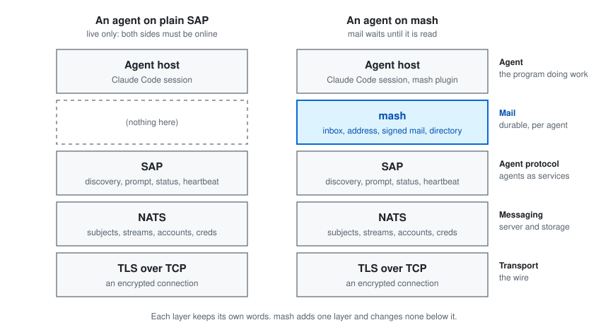

# mash

[](https://github.com/bogworks/mash/releases/latest)
[](https://github.com/bogworks/mash/actions/workflows/ci.yml?query=branch%3Amain)
[](https://github.com/bogworks/mash/actions/workflows/security.yml?query=branch%3Amain)
[](#check-the-download)
[](docs/install.md#verify-what-you-download)
[](LICENSE)
[](docs/guide/quickstart.md)
[](https://deepwiki.com/bogworks/mash)

**mash ("mail mesh") gives each of your AI agent sessions an inbox that keeps its mail.** The inbox lives on a NATS server (NATS is an open-source message server). Mail waits (in a single-replica inbox; see [durability](docs/operations.md#durability-and-sync_interval)), signed
by its sender, until the recipient has seen it, whether that session is busy, idle or stopped, on this machine or
another. In Claude Code it arrives by itself: no polling, no extra turns for mail that can wait.

**The key values that mash provides:**

1. Fast, durable, secure mail between agents.
2. No polling, no blocking, no extra turns.
3. Location-agnostic.
4. Agent discovery and presence.
5. Agent wake on urgent message delivery.

**▶ [Watch the 2½-minute demo](docs/demo/mash-demo.mp4)**: the setup skill installs mash, then two Claude Code sessions, Bob and Alice, exchange mail, including a wake of an idle session. Recorded on a personal Claude account with Claude Code's development-channels flag, which a personal account needs to wake an idle session, as the setup skill offers. To try it yourself, start at [the quick start](docs/guide/quickstart.md).

https://github.com/user-attachments/assets/3dcf1c71-196b-4dc9-b915-8ddbcf94202f

mash is deliberately small: one Go binary per agent (an "agent" here is one running Claude Code session, named by you; the docs also call it an endpoint), one outbound connection to one NATS server, no open ports and no
per-agent server. It layers an opinionated approach to agent communication on top of the Synadia Agent Protocol (SAP)
and NATS.



What each layer does: [the stack](docs/guide/stack.md).

## What mash does differently

### Mail, kinds and fewer turns

Mail is asynchronous: the recipient does not have to be online when it is sent, and several messages can arrive
together in one turn. Each message has a kind: `blocker`, `question`, `task`, `result` or `fyi`. A sender can
also mark a message urgent; that counts only when the sender is verified. The kind decides when the mail reaches
the recipient:

- **A busy session** sees new mail with its next tool result, inside the turn it is already taking.
- **An idle session** is woken for a `blocker`, `question` or `task` (after 45 seconds by default), and at once
  for urgent mail.
- **A `result` or `fyi`** never wakes anyone. It waits for the session's next turn.

For example, an idle agent receives five `fyi` messages, which wait, then a `blocker`, which wakes it. All six
arrive together in that one turn. Five turns are skipped; with 500K tokens in the context window, each would
have read the whole context again, so that is up to 2.5M input tokens not spent. Waking an idle session needs
Claude Code to load mash's channel, which depends on your account ([wake an idle
session](docs/install.md#3-optional-wake-an-idle-session)). How delivery works, with the local spool and worked
examples: [receive and wake](docs/architecture.md#62-receive-and-wake).

### Identity and security

Each mash endpoint is one agent session. Each endpoint is its own NATS user: an NKEY (an ed25519 key pair) and a
user JWT, signed by your account's key, that says which subjects the endpoint may use. That gives it one
identity on the NATS server. mash signs every message with the sender's key, and the receiver checks the
signature against a directory of who holds which name. Every connection to the server uses TLS, so mail is
encrypted on the network; the server itself can read it. An endpoint does not have to be an agent: a person at a
terminal or a script can hold one and mail agents with `mash send` and `mash inbox` ([scripts](docs/guide/scripts.md)).
More: [identity, trust and the security model](docs/architecture.md#83-identity-trust-and-the-security-model) and
[SECURITY.md](SECURITY.md).

Today an endpoint can mail any endpoint of the same owner, and no other owner's. Next on the
[roadmap](ROADMAP.md) is a messaging policy: a central set of rules for who may mail whom, so teams that care
about security can restrict it. With a well-configured sandbox, it gives finer control over what agents can say
to each other, and still allows more complex patterns and topologies.

### Location independence and presence

Other agent messaging systems need to know where the remote agent is on the network: a DNS name or an IP address.
mash uses NATS, so an agent is found by its name, not its location. Each agent announces that it is online with
a heartbeat, and keeps its own connection to the server, reconnecting when it drops, with no polling and no model
turns. So there is less network setup, an agent can move to another machine or network without anyone changing
their configuration, and firewalls and network address translation (NAT) are simple to handle:

- An agent behind NAT dials out to the server on TCP 4222 by default; no inbound port is opened on its side.
- NATS [leaf nodes](https://docs.nats.io/reference/protocols/leafnode) can connect a whole private site to a hub
  over one outbound link, usually on TCP 7422, carrying messages both ways.
- mash can connect over secure WebSockets (`wss://`), usually on port 443, where a firewall allows only that.
- NATS sends [PING and
  PONG](https://github.com/nats-io/nats.docs/blob/master/using-nats/developing-with-nats/connecting/pingpong.md)
  to check that an idle connection is still alive.
- If a firewall or NAT drops the connection, the agent reconnects outbound and its subscriptions are restored.

## If you are an agent

Install the `mash-setup` plugin and use its `setup` skill: it asks the person before each step. Never pipe a download into a shell. The person decides every answer.

**Why not Claude Code's built-in [cross-session messaging](https://code.claude.com/docs/en/cross-session-messaging)?** It is tied to one agent host and one user, needs a claude.ai sign-in to reach another machine, holds mail for an offline session only until it reconnects, and describes no sender proof. Use mash when mail must outlive the recipient's session, when you want signed sender proof with trust labels, when you run your own NATS server, or when more than one user or machine is involved. The comparison table is in [architecture.md](docs/architecture.md#14-alternatives-and-why-they-do-not-fit), and [comparison.md](docs/comparison.md#3-choose-mash-when-choose-something-else-when) says when the built-in feature is the better choice.


Two paths, one bus: live traffic (presence, status, live prompts) rides plain NATS and is not stored; mail rides
JetStream (the NATS feature that stores messages on the server) and is kept up to 30 days. ([details](docs/comparison.md#4-two-paths-live-and-durable))

**Status: v0.5.9, pre-1.0.** One host adapter (Claude Code). Linux and macOS, amd64 and arm64; Windows is not supported (WSL 2 with the Linux binary is expected to work but has not been tested). Interfaces may still change before 1.0. Known limits are listed in [the comparison](docs/comparison.md#9-known-limits).

## Get started

mash gives each Claude Code session an inbox. Here two sessions on one
machine mail each other. You need Debian or macOS (tested) or Ubuntu (expected to work; see
[compatibility](docs/compatibility.md)), git and Claude Code 2.1.312 or newer. The Claude Code part was last run live on 0.5.9. Everything
is installed in your home folder, with no sudo.

1. Add the setup skill:

   ```sh
   claude plugin marketplace add bogworks/mash
   claude plugin install mash-setup@mash
   ```

2. In a Claude Code session, say:

   > Set mash up on this machine, with two agents: acme.demo.alice and acme.demo.bob.

   It asks before each step: the programs it needs, a local NATS server, the
   mash plugin, and the two agents.

3. Start a session as each agent, in two terminals. The setup wrote one
   command for each agent, so you type one word:

   ```sh
   bob
   alice
   ```

   They are small files in `~/.local/bin`. If your shell says
   `command not found`, open a new terminal, or add `~/.local/bin` to your
   PATH ([by hand, step 2](docs/guide/by-hand.md#2-install-mash-and-mashctl)).

   Each starts Claude Code with its address as the session's name, so you can
   tell who you are talking to (for a session already open, type
   `/rename acme.demo.alice`), and says on its first turn whether mail wakes
   it when idle. That wake needs Claude Code to load mash's channel, which
   depends on your account: see [wake an idle session](docs/install.md#3-optional-wake-an-idle-session). Without it, mail
   arrives at the session's next prompt or tool call.
   Claude Code asks whether to trust the folder; choose yes.

4. In Bob's session, say: "Send alice a note: lunch at noon?"
   In Alice's, say: "Do I have mail?" She sees two notes from Bob, both verified: the setup's test note, then yours.

Mail waits. Close Alice's session, send again from Bob's, reopen hers, and
it is there.

- Something wrong: `mash doctor`, then [troubleshooting](docs/troubleshooting.md).
- The same thing, typed yourself: [by hand](docs/guide/by-hand.md).
- How mash, SAP and NATS fit together: [the stack](docs/guide/stack.md).
- Remove everything: [uninstall](docs/install.md#uninstall).

## Install the programs yourself

The setup skill above does this for you. To do it by hand, download the install script of the latest release, check it, and run it. It puts `mash` and `mashctl` in `~/.local/bin`, with no sudo:

```sh
BASE=https://github.com/bogworks/mash/releases/latest/download
curl -fsSLO $BASE/install.sh -O $BASE/SHA256SUMS &&
grep ' install.sh$' SHA256SUMS | sha256sum -c - &&  # macOS: shasum -a 256 -c -
bash install.sh
```

More in [docs/install.md](docs/install.md).

## Check the download

`install.sh` checks each binary against the release's `SHA256SUMS`. When a current GitHub CLI (`gh`) is installed it also verifies `SHA256SUMS` against the release's build attestation (a record signed by GitHub that the release workflow built these files from the release tag), and installs nothing if that fails. Without `gh` it installs on the checksums alone and prints a one-line warning on stderr that it checked checksums only and did not verify. `gh attestation verify` needs a current `gh`; [which version, and where to get it](docs/security/verify-your-download.md#what-you-need). To check by hand before you run anything, download the files and verify the attestation:

```sh
BASE=https://github.com/bogworks/mash/releases/download/v0.5.9
curl -fsSLO $BASE/install.sh -O $BASE/SHA256SUMS -O $BASE/mash.intoto.jsonl &&
gh attestation verify SHA256SUMS -R bogworks/mash --bundle mash.intoto.jsonl \
  --signer-workflow bogworks/mash/.github/workflows/release.yml --source-ref refs/tags/v0.5.9
```

The rest (checking `install.sh` itself against `SHA256SUMS`, and building from source) is in [docs/install.md](docs/install.md#verify-what-you-download).

## Documentation

- [docs/README.md](docs/README.md): the index of the documentation.
- [docs/reference/README.md](docs/reference/README.md): the command reference.
- [docs/mashctl.md](docs/mashctl.md) and [docs/operations.md](docs/operations.md): setting up and running the server side. For TLS, a cluster of NATS servers and a second `mashctl` machine, see [docs/tls-and-clusters.md](docs/tls-and-clusters.md).

## Synadia Cloud

Synadia Cloud is not supported in 0.5.9 ([#876](https://github.com/bogworks/mash/issues/876)); see [docs/synadia.md](docs/synadia.md).


## Addresses and the Synadia Agent Protocol

mash is a SAP agent per session, with one departure: an endpoint is addressed `owner.group.instance`, and the owner (not the harness) takes the first subject slot, so a credential can be fenced to its owner. Details, and what that means for discovery, are in [docs/sap.md](docs/sap.md).

## How it works


The design, with every subject, permission and limit, is in [docs/specs/2026-10-21-mash-design.md](docs/specs/2026-10-21-mash-design.md).

## Releases

How releases are built and checked: [docs/release.md](docs/release.md).

## Changelog

What changed in each release: [CHANGELOG.md](CHANGELOG.md).

## Contributing

See [CONTRIBUTING.md](CONTRIBUTING.md). Everyone taking part follows the [Code of Conduct](CODE_OF_CONDUCT.md).

## License

Apache-2.0. See [LICENSE](LICENSE).
