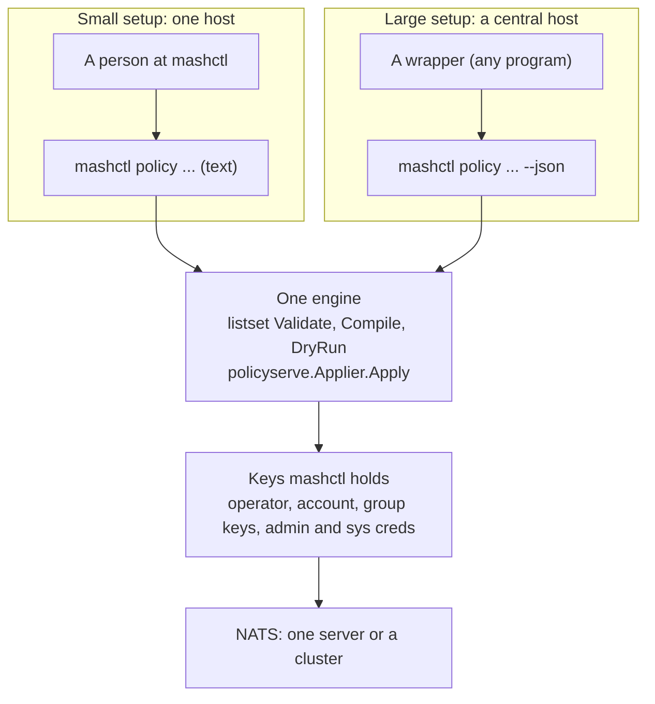
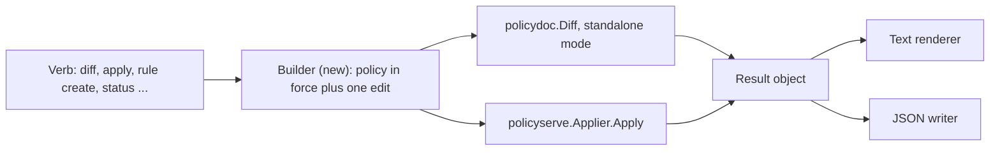

# A standalone policy command line for mash (design draft)

Status: draft for Randy, due 2026-11-16 10:00Z. Decided: nothing. Nothing in this document changes code.

How to read the marks. Each statement carries one mark. `[fact]` means I read it in the code or in a document and give
the place. `[choice]` means this draft proposes it and Randy may change it. `[open]` means it is not decided, or I could
not establish it.

Places. Two commits matter. `5e610e5` is the last commit before pull request #677. `08dc90e` is the head of #677
(branch `pr/ctl/v050-remove-policy-cli`), which removes the policy commands. A `path:line` in an engine package
(`internal/listset`, `policyapply`, `policyserve`, `policyintake`, `policyview`, `policydoc`, `reconcile`, `issue`,
`admin`, `sap`, `mint`) reads the same at both commits, because #677 does not touch those files (`git show --stat
08dc90e`). A `path:line` in a file that #677 removed (`cmd/mashctl/policy_*.go`) is read at `5e610e5`. A `path:line` in
a command file that #677 changed (`cmd/mashctl/add.go`, `main.go`, `internal/ctl/ctl.go`) is read at `08dc90e`.

Sources, named by short name in the marks. The four audits are in this repository under
`docs/design/standalone-audits/`; the other two are outside it and are summarised where they are used.

- `findings`: `standalone-audits/findings-standalone.md`, the summary of the three audits.
- `audit-policy`, `audit-provisioning`, `audit-json`: `standalone-audits/audit-policy.md`,
  `standalone-audits/audit-provisioning.md`, `standalone-audits/audit-json.md`. They cite line numbers at `5e610e5`.
- `inventory`: the lane core's stop-and-assess note of 2026-11-15 (not in this repository): which components of the
  policy engine are generic and which only serve an outside owner of the policy.
- `review`: the outside review of the v0.5.0 policy command line that Randy shared on 2026-11-15 (not in this
  repository). Appendix A answers each of its points.
- CLI standard: `cli/cli-STANDARD.md`, cited as "cli r1" to "cli r22". Writing standard:
  `cli/writing-for-the-operator-STANDARD.md`, cited as "wo r1" to "wo r11".
- ADR 0129: `docs/decisions/0129-the-policy-commands-are-not-part-of-v0-5-0-and-the-engine-stays-internal-until-it-works-standalone.md`
  at `08dc90e`.

## 1. Purpose, status and scope

Randy's rule, 2026-11-15: "ALL functionality works first for mash in isolation WITHOUT homerange or any other upwards
dependency. You MUST NOT implement functionality that has been designed for homerange without first having the
functionality work without homerange." His model: mash does not know homerange, and homerange wraps `mashctl`. Two
shapes of deployment follow. The small setup is one host, two or three groups of agents, one local NATS server in
relaxed mode and a person running `mashctl`. The large setup is 50 hosts, 200 or more groups of agents, a multi-server
NATS cluster and `mashctl` on a central host, driven by JSON in and JSON out. On the earlier draft he said: "it feels
like your working assumption is that mashctl is co-resident with mash; I think that's a bad assumption." On the command
line itself, 2026-11-15: "it's clunky, hard to understand, and only a mother could love it". He named two uses: "1. the
one a wrapper drives (ugly and messy is fine) 2. the one a normal human drives, which needs clear user stories: I, as a
developer, want to easily allow agent X to talk to agent Y to get status."

What v0.5.0 ships. #677 removes `mashctl policy` (`adopt`, `serve`, `reconcile`, `show`, `explain`, `diff`),
`mashctl issue serve`, `mashctl wrangler`, `mash policy show` and `mash policy explain`. It also removes the adoption
refusals and the account lock from `add`, `reissue`, `retire` and `label` (`08dc90e` diff of `cmd/mashctl/add.go`,
`label.go`, `reissue.go`, `retire.go`, `internal/ctl/ctl.go`; ADR 0129, "Removed from the v0.5.0 surface"). [fact]
`mashctl adopt`, the takeover of an operator-mode server you already run, stays and is a different thing (ADR 0129,
"Stays"). The engine packages and their tests stay, and no command calls them. [fact] In v0.5.0 nothing can set, read or
apply a policy: the `mashctl` dispatch has no `policy` case (`cmd/mashctl/main.go:28-57` at `08dc90e`). [fact]

What this document designs, for 0.5.5: the standalone policy command line over the existing engine. [choice]

The standalone model is the only model in this document. [choice] There is:

- no adoption, and no adoption marker;
- no outside submitter, and no submitter key;
- no wrangler, and no wrangler registry;
- no signed documents: a policy file is plain JSON;
- no issue service;
- no `range`: mash has no range concept (section 1.2).

The authority is whoever holds the keys `mashctl` uses: the operator key and the account key in the key store, the admin
credentials and the system credentials (`audit-policy` section 3, "What a central host needs on disk"). [choice] `mashctl`
is not assumed to run on the same host as NATS or as any endpoint (`findings`, verdict 1 to 3). [fact]

What happens to the adoption, signing and wrangler machinery in the code: it stays, untouched, unwired and outside this
design. [choice] That is the adoption marker and its guard (`internal/policyintake/adminmarker.go`, `internal/admin/
adoption.go`), the submitter and the signed document (`policydoc.DecodeOptions.Submitter`, `decode.go:43-47`), the
intake (`internal/policyintake`), `internal/reconcile`, and `internal/issue` with `internal/wranglerreg`. The design calls
none of them. It calls `policyserve.Applier.Apply`, which never reads the marker (`audit-policy` section 4, item 4;
`internal/policyserve/applier.go:183-189` reads only the document bytes). [fact] It decodes with
`policydoc.Decode(raw, DecodeOptions{})`, which accepts unsigned JSON (`internal/policydoc/decode.go:106-112`). [fact]

### 1.1 The two surfaces



### 1.2 What `range` leaving means

Randy: `range` "leaves" mash, because mash has no range concept. Core owns the rename. This section states only what the
command line needs, and every item depends on core's rename. [open: core]

What the code does today:

- The address is `agent.owner.name`. The first part is the SAP agent token (`internal/sap/identity.go:23-24, 89-101`).
  The subject of every operation is `agents.<verb>.<agent>.<owner>.<name>` (`identity.go:160`). The legacy form fixes the
  first part to `cc` (`internal/sap/subjects.go:10`; `identity.go:108-118`). [fact]
- The list-set engine calls the first part `range`. A list set has one value of it, and every sender, allow entry, deny
  entry and group must carry that value (`internal/listset/listset.go:62-64`; `validate.go:90, 101-103, 146-148,
  204-205`). [fact]
- A tag holds `owner.name` only. The first part sits as a literal in every template line. This keeps a tag short and
  stops a tag from naming an address outside the account's first part (`internal/listset/compile.go:11-16, 104, 134-147`).
  [fact]
- The list-set file has a top-level `range` field and keys each group by its owner part only
  (`internal/policydoc/decode.go:86, 175, 186, 217-218, 230`). [fact]
- The policy bucket name is a pattern with `{range}` (`internal/policyapply/seam.go:15, 22, 34-38`). The template gives
  every sender a publish line to `agents.policy.<range>` (`compile.go:150, 166-169`). [fact]

What the command line needs from core:

1. A name for the first address part. This draft says "first part" and uses `home` as its value in the mockups.
2. Whether the list-set file keeps a top-level field for it, and its name. The JSON keys below follow core's name.
3. Whether one account has one value of it (today) or several. Several means a tag carries `first.owner.name`, which is
   longer and counts against the 4,096-byte connect line (`internal/listset/size.go:12-20`), or a template needs one
   line per value.
4. The policy bucket name without `{range}`, owned by mash.

What the command line does about it. [choice] No new command takes `--range`. The first part comes from the policy in
force, or from the first address on the command line. A person types the full address. A view may omit the first part
and says so.

## 2. User stories

Seven facts about v0.5.0 shape every story. They come first.

- F1. No command sets, reads or applies a policy. [fact: `cmd/mashctl/main.go:28-57` at `08dc90e`; ADR 0129]
- F2. With no policy, a user made by `mashctl add` may mail, prompt and probe every endpoint of its owner and watch their
  heartbeats. One deployment has one owner. [fact: `internal/admin/permissions.go:27-49`; `audit-provisioning` C9] So in
  a deployment with one owner, "allow X to talk to Y" changes nothing until something closes the owner line.
- F3. A policy governs only users signed by an owner-group scoped key and carrying tags. `add` signs with the account key
  and puts the permissions in the JWT, so a policy does not change what an `add` endpoint may do. [fact:
  `internal/mint/mint.go:1-5, 70-74`; `internal/listset/compile.go:34-36`; `audit-policy` section 8]
- F4. A policy names three-part addresses, and the first part may not be `cc` (`internal/listset/validate.go:25-33`;
  `internal/sap/identity.go:89-91`). `add` makes only the legacy form: a name with no dots and subjects with `cc`
  (`cmd/mashctl/add.go:197` at `08dc90e`; `identity.go:108-118`). So an endpoint made by `add` cannot be named in a
  policy. [fact] Three-part endpoints are made by `provision` with the `agent_token` setting, which makes a directory
  record and an inbox and no credential (`docs/operations.md:251-253` at `08dc90e`;
  `audit-provisioning`, "provision", "Gap"). [fact]
- F5. Adding a permission to a sender needs a new credential for it, because the permission is a tag in the credential.
  The apply does not issue it (`internal/listset/dryrun.go:55-60`, `NewCredential`). Removing a permission by tag
  (narrowing) is refused before the push (`internal/policyserve/failclosed.go:217-218`; `applier.go:291-297`). The
  rotation code exists (`internal/policyapply/rotate.go:124, 266-291`), but the Applier fills only the leaving senders
  (`applier.go:373-381`). [fact]
- F6. A first policy must state all four switches for every owner group that has a sender
  (`internal/listset/validate.go:180-186`). [fact]
- F7. No command creates the policy bucket. The ledger code refuses when it is missing
  (`internal/policyapply/kvledger.go:33-35, 123-125`). [fact]

### Story 1: allow agent X to talk to agent Y to get status (Randy's story)

- Who: a developer who runs agents `home.dev.x` and `home.dev.y`.
- Wants: "I, as a developer, want to easily allow agent X to talk to agent Y to get status."
- Today: nothing. F1 and F3. Within one owner the agents already reach each other (F2). [fact]
- Gap: no verb; the engine has no driver (`inventory` section 1, finding 1). One allow entry grants all four operations:
  mail, prompt, status and heartbeat (`internal/listset/compile.go:13-16, 103-105`; `explain.go:231-232`). Status
  alone is possible only by sharing status in the whole owner group (`explain.go:233-234`). [fact]
- Target: one command names X and Y, shows what the change grants and who else it affects, names the credential work,
  applies it and says what is verified (section 7, mockup iv). Whether it grants one operation or the pair is
  question 5.

### Story 2: who can talk to whom

- Who: a developer or operator who needs the picture of the account.
- Today: no command. The engine has the data: `listset.Show` returns the switches, each sender's allow and deny lists and
  its reach (`internal/listset/explain.go:117-169`). [fact]
- Gap: the old output listed open subjects first and had no row per relationship (`review`, part 2; the golden files
  removed by #677). [fact]
- Target: the rule-row view (section 7, mockup i), read with the admin credentials the person already holds. [choice]

### Story 3: why can't X reach Y

- Who: a developer whose agent got a refusal.
- Today: no command. The engine's `Explain` gives, per operation, allowed or not, a reason code and one sentence
  (`internal/listset/explain.go:178-247`). It describes the policy, not the credential in the agent's hand
  (`explain.go:14-16`). A sender missing from the policy is an error (`explain.go:196-198`). [fact]
- Gap: with no policy, the answer is "the owner line applies to `add` credentials" (F2, F3), which the engine cannot
  say. [fact]
- Target: scope line first, then decision and plain reason per operation, then what was and was not checked, then the
  next action (mockup ii).

### Story 4: take access away

- Who: an operator during an incident, or a developer who made a mistake.
- Today, without a policy command: `mashctl suspend NAME` refuses inbound mail to one endpoint and leaves its credentials
  valid; `mashctl retire` and `deprovision` revoke the endpoint's user key (`audit-json` sections "suspend" and
  "retire"). [fact]
- Through the engine, the ways that work: close a shared operation for an owner group, which changes a template and
  disconnects every connection under that group's key (`internal/listset/dryrun.go:81-91`); remove a sender, which
  revokes every key issued for it (`dryrun.go:58-59`; `internal/policyapply/rotate.go:240-264`). [fact]
- Through the engine, the way that is refused: remove one allow entry, or add one deny entry, for a sender that holds a
  credential (F5). [fact]
- Gap: the common wish, "stop X reaching Y", is the refused case. [fact]
- Target: `policy rule delete` says up front which ways apply and which are `unsupported` in this release, and does the
  one the person picks. Until the rotation work (section 10, item N8) it returns outcome `unsupported`. [choice]

### Story 5: is my change live

- Who: whoever changed the policy and needs to know that access changed.
- Today: no command. The engine keeps the generation in force, the latest attempt and the generation each server holds
  (`internal/policydoc/read.go:42-55, 74-107`). [fact]
- Gap: nothing compares the credential with the policy, and nothing tries an operation on demand (section 3.4). [fact]
- Target: `policy status` prints four separate answers: policy, credential, servers, live.

### Story 6: what can't I undo

- Who: an operator about to remove a sender or close an owner group.
- Today: no command. The plan the engine computes says which senders are revoked and which groups disconnect
  (`internal/listset/dryrun.go:35-62, 81-91`). [fact]
- What is irreversible in the standalone model: a revoked public key stays revoked and is never issued a credential again
  (`internal/issue/issuer.go:205-207, 234-236`, refusals for a revoked key); every connection under a changed template's
  key is cut (`dryrun.go:81-83`); a generation number only goes up, and there is no rollback verb (`decode.go:189`). A
  revert is a new generation with the old content. [fact]
- Target: impact first, then what is irreversible, then what to type (mockup iii).

### Story 7: a new agent must report to its lead

- Who: a developer who starts `home.dev.new`, which must mail `home.dev.lead`.
- Today: `mashctl add` makes a legacy endpoint that the policy cannot name (F4). [fact]
- Gap: the steps for a three-part endpoint are in an order that blocks itself. The apply refuses an added address with no
  inbox (`internal/policyserve/failclosed.go:183-216`). The inbox record needs the user's public key
  (`audit-provisioning`, "provision"). A credential can be signed only after the apply has published the owner group's
  template (`internal/issue/issuer.go:219-230`, `checkScope`). So: key and inbox first, apply second, credential last.
  [fact]
- Target: three commands in that order, each idempotent, each naming the next (mockup iv, steps 3, 5 and 6). Whether
  they merge into one is question 7.

### Story 8: a solo developer's first five minutes

- Who: one person, one laptop, one local NATS server in relaxed mode.
- Wants: `init --local`, two agents, one allow, and a way to see that it works.
- Today: `mashctl init --local --owner dev --start` makes the server, the keys, the credentials and the directory and
  lease buckets (`internal/ctl/ctl.go:95`; `internal/ctl/local.go:30-35` at `08dc90e`). The account JWT carries no signing
  keys (no reference in `internal/bootstrap`), so the first apply meets no foreign signing key
  (`internal/policyserve/signer.go:123-126, 199-200`). [fact] After that, F1 to F7 apply. [fact]
- Gap: no policy bucket, no verb, no way to make a credential a policy can govern.
- Target: mockup iv. The sequence is `init --local`, `policy init`, `endpoint create` twice, `policy rule create`,
  `credential create` twice, `policy status`.

### Story 9: the wrapper (large setup)

- Who: a program on a central host that drives `mashctl` against a remote cluster with 200 or more endpoints. It is not
  on the cluster's hosts.
- Wants: the same operations as JSON in and JSON out, no seed on the central host, one documented exit-code table.
- Today: `mashctl` works from a central host for everything that only talks to NATS (`findings`, verdict 1). The
  credential commands assume the key store, the system credentials and the endpoint's creds file sit together
  (`findings`, verdict 2). Every state-changing command prints text only, no command returns a JSON error, the same fault
  exits 1, 2 or 3 depending on the command, and policy has no path at all (`audit-json` sections 0, 2 and 4). [fact]
- Target: the same verbs, `--json` on each, one outcome object, one exit-code table, a document by stdin, a credential
  signed for a public key (section 4). Mockup iv shows the JSON session.

## 3. The surface

### 3.1 The engine and the direct path

The direct path takes "allow X to Y" to an applied policy with the keys `mashctl` holds and no signature. Core's
inventory (section 3) and `audit-policy` (section 7) agree on the steps. The table says which existing function each
step calls and what is missing. Sizes: S is 1 to 2 working days, M is 3 to 5, L is 6 to 10, each with tests. They are
estimates, not commitments. [open]

| Step | Existing function | Place | Missing: new work, size, depends on |
|---|---|---|---|
| Load config and keys | `loadCtlConfig`, `openKeys` | used by `add` (`audit-policy` section 7, step 1) | none |
| Create the policy bucket | none: `NewKVLedger` fails when it is missing | `internal/policyapply/kvledger.go:114-125` | N1: `policy init` creates a mash-owned bucket. S. Depends on core's bucket name |
| Read the policy in force | `KVLedger.InForceViewAndStatus` | `internal/policydoc/read.go:19-26` | none |
| Build the next policy from "allow X Y" | none | `internal/listset/listset.go:62-92` (the types) | N2: builder over `ListSet` (add sender, add the four switches of a new group, add the allow or deny entry). M. Depends on question 6 for the new-group default |
| Validate, compile, size, plan | `listset.Validate`, `Compile`, `DryRun`; `policydoc.Diff` | `validate.go:81`, `compile.go:64`, `dryrun.go:131`, `read.go:403` | N5: `Diff` has adoption, signature and rotation checks. With `rc` nil it checks none of them (`read.go:281-284, 442-445`), and the plan then says "not checked". A standalone mode drops those lines. S |
| Make the document bytes | none: only `Decode` exists | `internal/policydoc/decode.go:102` | N3: `policydoc.Encode(Document)` to canonical JSON, round-trip tested with `Decode`. S. Or `Apply` takes a decoded document (`applier.go:189` decodes `Raw`). Both are S |
| Take the account lock | `Admin.LockAccount` | `internal/admin/accountlock.go:43-59` | a `policyintake.Guard` adapter over the lock (`Before(ctx, what) error`, `internal/policyintake/intake.go:136-140`). S. Part of N4 |
| Apply | `policyserve.Applier.Apply` | `internal/policyserve/applier.go:183` | N4: build the Applier as `policy serve` did: `Account`, `Ledger`, `Sys`, `Keys`, `Trust`, `Record`, `KV`, `Servers`, `URL`, `Vet`, `Options`, `Load`, `Inboxes`, plus the admin fields (`applier.go:38-80`; `audit-policy` section 7, item 7). M, plus a live test over a two-server cluster. Depends on N1, N3 |
| Sign a credential for X | `GroupUserIssuer.Issue`; the back half of `issue.Issuer.issue` | `internal/policyapply/rotate.go:44-71`; `internal/issue/issuer.go:172-263` | N6: `credential create`: lines 172-263 without the registry, proof and nonce steps (135-170), plus key generation or `--user PUB`, the directory record and inbox, the creds file. M. Depends on N4 (the template must be published) |
| Credential check | the issue record keeps tags per issued key | `internal/issue/issuer.go:247-251` | N10: compare the latest recorded tags of an address with `Compiled.Users[].Tags`. S |
| Live check | `ProbeMinter.Mint`, `LiveProber.Refused` | `internal/policyapply/probe.go:44, 201` | N9: an on-demand probe. M. It writes probe records (see 3.2, `policy status --live`) |
| Take access away by tag | `Rotate`, `RotationPlan.Narrowed`, `Deliverer` | `rotate.go:124, 266-291`; `failclosed.go:172-181, 217-218` | N8: fill `Narrowed` in the Applier, name the new key per narrowed sender, give a `Deliverer`. L. Depends on N6 and question 4 |
| Deliver a credential | `FailClosedDeliverer` always errors | `failclosed.go:172-181` | the delivery answer, question 4 |

[fact for the existing functions and places; choice for the new work; open for the sizes]

Two facts about the direct path that the table does not hold:

- The policy push does not take the host-local lock `apply.lock`. Only the revoking commands do (`internal/apply/
  revoke.go:75`; `internal/ctlkeys/lock.go:14-26`). #677 removed the account lock from `retire`, `reissue` and `add`
  (`08dc90e` diff of `cmd/mashctl/retire.go:85-91`). So a policy apply and a `retire` are not serialised, and both
  read, change and push the account JWT. The driver must take the account lock and `apply.lock`, and the revoking
  commands must take the account lock (section 4, item 8). [fact; the consequence is inferred, open]
- The first apply refuses an account JWT that carries a signing key which is not an owner-group key, unless the issuer
  fields are set (`internal/policyserve/signer.go:123-126, 199-200`; `canDrop`, `signer.go:119-121`). A server taken over
  by `mashctl adopt` may carry one. I did not establish whether it does. [open]

### 3.2 The verbs

The CLI standard allows `<tool> <noun> <verb>`, one noun and at most one sub-noun, one positional argument, and the verbs
in cli r4: `list`, `show`, `status`, `watch`, `explain`, `diff`, `print`, `create`, `apply`, `init`, `delete`, `start`,
`stop`, `restore`, `adopt`, `run`, `ensure`, `serve` (`cli-STANDARD.md:65-100`). `allow` and `deny` are not in the set,
and `allow X Y` has two positional arguments, which cli r7 forbids (`cli-STANDARD.md:114`). So the conforming form of
Randy's story is `mashctl policy rule create --from X --to Y`. The short form `mashctl policy allow X Y` needs two
exceptions, to cli r4 and cli r7, recorded as the standard's Exceptions section allows (`cli-STANDARD.md:195-198`). That
is question 1. [fact for the rules; choice for the form]

Working names. The names are question 1. Existing top-level verbs (`add`, `reissue`, `retire`) stay until mash's major
revision (`cli-STANDARD.md:200-233`). New verbs conform. [choice]

| Command | What it does |
|---|---|
| `mashctl policy init` | creates the policy bucket |
| `mashctl policy print` | writes the next-generation document of the policy in force to stdout, to edit |
| `mashctl policy diff FILE` | previews a policy file; changes nothing |
| `mashctl policy apply FILE` | applies a policy file |
| `mashctl policy show` | the rule-row view of the policy in force |
| `mashctl policy explain RECEIVER --from SENDER` | the drill-down for one pair |
| `mashctl policy status [ADDRESS]` | policy, credential, servers, live |
| `mashctl policy rule create --from X --to Y` | allow or deny one pair |
| `mashctl policy rule delete --from X --to Y` | take a rule away |
| `mashctl endpoint create ADDRESS` | key, directory record, inbox for a three-part address |
| `mashctl credential create ADDRESS` | sign the policy credential for an address |

Common to every command, unless a row says otherwise. [choice]

- Connection: `MASH_URL`, `MASH_OWNER`, `MASH_ADMIN_CREDS` and the key store, as every `mashctl` verb (`audit-json`
  section 0). Commands that push take `--servers N` and `--sys-creds FILE`. They are flags from the first release of
  these commands, not environment only.
- `--json` prints one JSON document to stdout and nothing else (cli r10). Progress and warnings go to stderr (cli r12).
- Every JSON object has `outcome`, `exit`, `message` and a `schema` field naming it, such as `mash.policy.apply`. The
  `schema` gets a revision number when a key is removed or changes meaning, the rule `audit` already follows
  (`audit-json` section 1, "audit").
- A refusal carries `refusals[]` with `stage`, `entry` and `reason`, as the plan does today
  (`internal/listset/dryrun.go:64-69`), and each may carry `next`.
- An error is `{"outcome":"error","exit":6,"error":{"code":"...","message":"...","next":"..."}}`. The text form is two
  sentences: what failed and what to do (cli r13).
- Exit codes are the table in section 5.

#### `policy init`

- Synopsis: `mashctl policy init [--dry-run] [--json]`.
- Reads: the admin connection. Writes: one KV bucket, mash-owned name (core decides). It writes no policy.
- Confirmation: none; an empty bucket is harmless.
- Idempotent: yes. A second run is outcome `unchanged`, exit 0.
- JSON keys: `bucket`, `created`.
- Open: whether `mashctl init` does this instead (question 8).

#### `policy print`

- Synopsis: `mashctl policy print [--json]`.
- Reads: the ledger. Writes: stdout only. With no policy in force it prints a document with generation 1 and base 0 and
  empty groups and senders.
- It prints `account`, `generation` (in force plus one), `base_generation` (in force) and `issued_at`, so a person edits
  the rules and not the arithmetic (`internal/policydoc/decode.go:171-190` requires all of them, and generation equal to
  base plus one). [fact for the requirement; choice for the verb]
- Idempotent: yes (read only). JSON: the document itself.

#### `policy diff FILE`

- Synopsis: `mashctl policy diff FILE|- [--servers N] [--sys-creds FILE] [--json]`. `-` reads stdin.
- Reads: the file, the ledger, the inbox of each added address (`failclosed.go:195-216`), and with `--sys-creds` each
  server's limits (`ReadServers`, `internal/policyserve/applier.go:259`). Writes: nothing.
- Without `--sys-creds` the size check uses the default limits and says so (`internal/policydoc/read.go:191-195`).
  [fact]
- Exit: 0 for `planned` and `unchanged`; 1 for `invalid`, `unsupported`, `stale`, `blocked`; 2 usage; 4 not authorized;
  6 error.
- JSON keys: `plan` (the engine's `refused`, `refusals`, `receivers`, `templates`, `tags`, `rotate_and_revoke`,
  `new_credential`, `revoke`, `first_credential`, `size_limits`), `checks[]`, `credential_work[]`, `message`.
- Idempotent: yes. A document equal to the policy in force is outcome `unchanged`, exit 0, "No changes needed".

#### `policy apply FILE`

- Synopsis: `mashctl policy apply FILE|- [--dry-run] [--yes] [--servers N] [--sys-creds FILE] [--json]`.
- Reads: as `diff`. Writes: scoped signing keys for new owner groups (`applier.go:301-313`), the account JWT on every
  server, the ledger (generation and status), and revocations for leaving senders. It issues no credential.
- Confirmation: required when the plan has `templates[].disconnects` true or a non-empty `revoke`
  (`internal/listset/dryrun.go:58-59, 81-91`). On a terminal it asks for the account's name. `--yes` answers it. With no
  terminal and no `--yes` it exits 2 and names `--yes` (cli r15). [choice]
- Exit: as `diff`, plus 3 cancelled and 5 partial (the push began and the gate did not pass on every server).
- JSON keys: `generation`, `base_generation`, `plan`, `checks[]`, `states` (section 3.4), `credential_work[]`, `message`.
- Idempotent: re-running the same file after a stop finishes it. A stopped apply leaves a pending generation, and only
  the same content may follow (`read.go:435-440`; restart tests, `audit-policy` section 2.2, "When the host dies"). Re-
  running a finished file is `unchanged`. [fact for the pending rule; open for the resume, which I did not run]

#### `policy show`

- Synopsis: `mashctl policy show [--by-operation] [--json]`.
- Reads: the ledger over the admin connection (no sys credentials). Writes: nothing.
- Output: scope line, the rows, the legend (mockup i). `--by-operation` is the column view.
- Exit: 0, also when no policy is in force. 4 not authorized. 6 error.
- JSON keys: `policy_in_force`, `generation`, `servers[]`, `partial`, `rows[]` (`action`, `from`, `to`, `operations`),
  `switches[]`, and the engine's `view` (`internal/listset/explain.go:39-52`). The open subjects are in `view` only.
- Idempotent: yes.

#### `policy explain RECEIVER --from SENDER`

- Synopsis: `mashctl policy explain RECEIVER --from SENDER [--details] [--json]`. One positional (cli r7). [choice]
- Output: scope line, one row per operation with decision, plain reason and reason code, what was checked, next action.
  `--details` adds the matching rows, the credential tags and the open subjects.
- Exit: 0 whether the answer is allowed or denied; the answer is data. This is what `explain` did
  (`audit-json`, "policy explain"). 1 `invalid` for an address the engine refuses; 4; 6.
- JSON keys: `sender`, `receiver`, `operations[]` (`operation`, `allowed`, `reason`, `detail`), `states`, `next[]`.
- Idempotent: yes.

#### `policy status [ADDRESS]`

- Synopsis: `mashctl policy status [ADDRESS] [--servers N] [--sys-creds FILE] [--live] [--json]`.
- With an address: the four states for that sender. Without: one line per sender with the same four.
- Reads: the ledger, the issue record, and with `--sys-creds` the connected keys (the check `issued check` makes). It
  writes nothing, except with `--live` (below).
- Exit: 0 when every checked state is as the policy needs; 1 `blocked` when a checked state is not (for example the
  credential lacks a tag); 5 `partial` when servers differ; 4; 6. [choice]
- JSON keys: `states.policy`, `states.credential`, `states.servers`, `states.live`, each `{result, detail}` with
  `result` one of `checked` and `not_checked`, and a `value`.
- `--live` mints a probe credential per probe, records it in the issue record and revokes it afterwards
  (`internal/policyapply/probe.go:28-44`; `internal/policyserve/applier.go:147-170`). That changes state, so `status
  --live` conflicts with cli r4 (`status` is read only) and cli r11 (a changing command takes `--dry-run`). It is
  question 9.

#### `policy rule create` and `policy rule delete`

- Synopsis: `mashctl policy rule create --from SENDER --to RECEIVER [--effect allow|deny] [--operation OP]... [--grant
  pair|group] [--dry-run] [--yes] [--servers N] [--sys-creds FILE] [--json]`; `delete` takes the same selectors.
- What it does: reads the policy in force, applies the edit through the builder (N2), and runs the same preview and apply
  as `policy apply`. It adds the sender and the receiver to the policy as senders if they are missing, so that both can
  get a credential: a receiver that is not a sender cannot be issued one (`internal/issue/issuer.go:186-187`; a sender
  with empty lists is still listed, `listset.go:70-72`). [choice]
- One allow entry grants mail, prompt, status and heartbeat together (`compile.go:13-16, 103-105`). So `--operation` has
  two answers: grant the pair for all four, or flip the group's switch for that operation. `--grant pair|group`
  chooses. With a subset of operations and no `--grant`, a terminal prompts and a script exits 2 naming `--grant`
  (cli r15). Question 5. [fact for the engine; choice for the flags]
- `--effect deny` takes an address away from a shared operation in the sender's own group. The engine refuses a deny
  outside the group, on a group with no shared operation, or on an address that is also allowed
  (`validate.go:159-170`). [fact]
- `rule delete` of an allow entry or a new deny entry is narrowing: outcome `unsupported` until N8 (F5). Removing a deny
  entry or flipping a switch is not narrowing (`dryrun.go:100-120`). [fact]
- Confirmation: as `policy apply`, and also when the policy is the first one and it closes an owner line that credentials
  from `add` use (F2, F3).
- Idempotent: creating a rule that exists is `unchanged`, exit 0.
- JSON keys: as `policy apply`, plus `request{from,to,effect,operations}` and `credential_work[]` naming each address
  that needs `credential create`.

#### `endpoint create` and `credential create`

- `mashctl endpoint create ADDRESS [--user PUB] [--note T] [--dry-run] [--json]`. Makes the user key (or takes
  `--user PUB`), the directory record, the inbox and the issue-record entry for a three-part address. It makes no
  credential. Where the seed waits until `credential create` is question 7. [choice]
- `mashctl credential create ADDRESS [--creds-out FILE] [--dry-run] [--json]`. Requires that the policy in force lists
  the address and that its template is published. Signs the tagged user JWT with the owner group's scoped key and
  records it (the back half of `issue.Issuer.issue`, `internal/issue/issuer.go:172-263`). With a seed it writes the creds
  file at `--creds-out`, mode 0600, never over an existing file. With `--user PUB` at `endpoint create` it returns the
  JWT and no seed exists on this host. It never prints a seed. [choice]
- Exit: as above. A call with the policy not applied is `blocked`, exit 1, `next` names the command to run.
- Idempotent: a second run for the same key and tags is `unchanged`. Changed tags sign a new JWT for the recorded key
  (`audit-provisioning`, change 7). [choice]
- JSON keys: `address`, `public_key`, `tags[]`, `generation`, `creds_path` (when written), `jwt` (with `--user PUB`).

### 3.3 One machine surface, one human surface, one engine

There is one engine and one path. [choice]

- Every command computes one result object and returns it. `--json` prints that object. The text form is rendered from
  the same object by functions that read only the object. [choice]
- A human flag (`--details`, `--by-operation`) changes rendering only. No flag changes what is applied.
- A wrapper and a person call the same verbs. There is no human-only shortcut and no wrapper-only verb.
- The JSON key names and the outcome classes are stable. The text may change. Golden tests pin both, and the text golden
  tests are generated from the JSON fixtures.



### 3.4 Four states the output keeps apart

Applied policy is not changed access. The output names four states and never lets one stand for another. [choice,
from `review` point 2]

| State | Question | Can mash check it today | How, or what is missing |
|---|---|---|---|
| Policy | What does the document permit? | Yes, by the engine, no command | `policydoc.Show` and `Explain` read the ledger (`internal/policydoc/read.go:145-178`). They say they describe the policy and not an installed credential (`internal/listset/explain.go:14-16`). |
| Servers | Did every server accept the generation? | Yes, by the engine, no command | The status holds the generation each server reports (`read.go:42-55, 74-85`). |
| Credential | What does the endpoint's credential carry? | No | The issue record holds tags per issued key (`issuer.go:247-251`). A command can compare the latest recorded tags with the policy's tags (N10). That shows what was issued, not what the endpoint holds. Whether the issued key is connected comes from the connections scan that `issued check` makes (`audit-json`, "issued check"). The endpoint's own creds file is not reachable from a central host. |
| Live | Did an operation succeed or fail? | Only for removals, during an apply | The gate mints a probe with the sender's name and tags and requires the removed reach refused (`internal/policyapply/probe.go:199-265`). Nothing runs it on demand (N9). A probe tests the template and the tags, not the credential in the endpoint's hand. |

[fact for the engine and the places; open for the credential check]

The output rule. [choice] Every answer prints the four states, each as `checked` with its result or `not checked`. When
the credential is not checked the line reads `credential: not checked`. "Applied" never reads as "access changed and
verified".

## 4. Central-host and JSON requirements (the 0.5.5 drivable work)

These come from `audit-json`, `audit-provisioning` and `audit-policy`. They are listed in the order to do them. The
column "Policy CLI needs it" says whether the policy command line fails from a central host without it. A "no" is a
separate item and not part of this design. Sizes as in 3.1. [open for the sizes]

| # | Item | Policy CLI needs it | Audit reference | Size |
|---|---|---|---|---|
| 1 | Flag parity for the new commands: `--servers`, `--sys-creds`, and `--creds-out` on `credential create`. They exist from the first release of the new commands | yes | `audit-provisioning` change 3 and 4 | 0 extra; the new commands take them |
| 2 | The same flags on `add`, `reissue`, `retire`, `deprovision`, `unzone`, and `--creds` for `reissue` and `retire`. Today these read only the environment, and the `adopt` hint names a flag they reject (`cmd/mashctl/adopt.go:286` per the audit) | no | `audit-provisioning` change 3, 4 and 1 | S |
| 3 | `--json` and a documented outcome object on every new state-changing command | yes | `audit-json` gap 2 | in each verb's size |
| 4 | The same on the existing state-changing commands (`provision`, `add`, `reissue`, `retire`, `deprovision`, `set-meta`, `label`, `suspend`, `resume`, `limits`, `unzone`, `init`) | no | `audit-json` gap 2; `audit-provisioning` change 5 | M |
| 5 | A JSON error object and one documented exit-code table (section 5) for the new commands | yes | `audit-json` gap 1 and 6 | S |
| 6 | The table applied to the existing commands | no | `audit-json` section 2 | S, and a compatibility question 10 |
| 7 | A policy document by stdin: `diff -` and `apply -` | yes | `audit-policy` section 2.4; `audit-json` gap 10 | S |
| 8 | A bucket-creating command: `policy init` (N1) | yes | `audit-policy` section 0, point 3; `findings` change 6 | S |
| 9 | Mint for a public key: `endpoint create --user PUB` and `credential create`, so no seed is on the central host. Also a `reissue` mode that signs for the recorded key | yes for the policy credential; no for `reissue` | `audit-provisioning` change 7 | M (N6) |
| 10 | Locks that work across hosts. The ledger lease and the account lock are in NATS and hold across hosts (`internal/policyapply/kvledger.go:82-86`; `internal/admin/accountlock.go:43-59`). The `apply.lock` is a file on one host and is not taken by the policy push (3.1). The revoking commands need the account lock back, and the JWT write needs a NATS lock | yes when two hosts or two commands write the account JWT | `audit-provisioning` C4 and change 8 | M |
| 11 | A per-server address override. The Applier dials the host and port each server reports and ignores the configured list (`internal/policyserve/servers.go:149-151`, `audit-policy` section 2.2b). A cluster that advertises internal addresses fails from a central host | yes for a cluster behind an address translation | `audit-policy` section 6, item 3 | S |
| 12 | Batch input for credentials: one call for many addresses. 200 endpoints cost 200 process starts, each with an admin connection and a 30 s deadline | no, but the large setup feels it | `audit-json` gap 10 | M |
| 13 | A cluster joined by gateways is never "complete", so the push refuses it (`internal/apply/apply.go:61` per the audit) | only for gateway deployments | `audit-policy` section 2.2b; `audit-provisioning` change 9 | M to L |
| 14 | Text fixes and the central-host recipe in `docs/operations.md`: one environment set per account | no | `findings` changes 1 and 2 | S |
| 15 | `wrangler list --json`, `issue serve` readiness | not applicable: removed by #677 | `audit-json` gap 8 | none |

Items 1, 3, 5, 7, 8 and 9 are needed for the policy command line to work from a central host, and they are part of
sections 3 and 10. The rest are separate. [choice] Item 10 is the one a reader may miss: the policy apply is safe
against another policy apply on any host, and not against a `retire`. [fact for the locks; inferred for the effect]

Scale. A policy is one document, so 200 owner groups are one `apply`, not 200 calls. The limits are the account JWT at
1 MiB with one scoped key per owner group and a user JWT of about 3,750 bytes with its tags (`internal/listset/
size.go:12-25`). `diff` checks both and, with `--sys-creds`, against each server's own limits. [fact]

## 5. Outcome classes and exit codes

The table already sent to core, reconciled with the standalone model and with the codes `mashctl` uses today.

| Outcome | When | Stage names today | Exit | Today |
|---|---|---|---|---|
| `applied` | The gate passed on every server | state `applied` | 0 | none: no command |
| `planned` | A dry run computed the plan | none | 0 | `diff` exit 0 |
| `unchanged` | The document equals the policy in force: a satisfied state | `unchanged` (`internal/policydoc/read.go:475-477`) | 0 | `diff` exited 1 (`audit-json`, "policy diff") |
| `invalid` | Malformed document or a broken rule | `validate`, `check`, `document`, `range` (core renames it) | 1 | 1 |
| `unsupported` | The engine cannot do it in this release | `narrowing` | 1 | 1 |
| `stale` | The base is not the generation in force, or a different generation is pending | `base`, `pending` | 1 | 1 |
| `blocked` | A precondition fails: an added address has no inbox, the document does not fit a server, the policy in force does not compile | `inbox`, `size`, `in_force` | 1 | 1 |
| `partial` | The push began and the servers differ | state `partial` | 5 | `show` exit 0 |
| `error` | The command could not complete: no connection, unreadable file, internal failure | none | 6 | 1, 2 or 3 by command |
| `signature_failed` | not reachable in the standalone model | `signature` | not used | 1 |

Usage is 2. Cancelled is 3. Not authorized is 4. They are the CLI standard's own (cli r14, `cli-STANDARD.md:141-142`).
Exit 5 and 6 are documented on the reference page, as cli r14 allows. [choice]

Differences from the table sent to core:

- `signature_failed` is dropped from the live table. The decoder reports a bad signature only when a submitter key is
  passed (`internal/policydoc/decode.go:111-112, 145-153`), and the standalone path passes none. [fact]
- Exit 4 no longer means a bad signature. It means not authorized: the admin credentials are refused, or the key store
  lacks a key the command needs. [choice]
- `adoption` is dropped. The stage cannot occur without a marker (`internal/policydoc/read.go:278-300`). [fact]

What the existing commands do today (`audit-json` section 2, lines 172-181):

| Code | Meaning today, by command | Conflict with the table or with cli r14 |
|---|---|---|
| 0 | success in all; also `label` unchanged, `unzone` already done, `audit` with findings and no `--strict` | Not a conflict. The outcome is in text only. |
| 1 | failure in all; also `audit --strict` findings, `issued check` finding, `retire` after the server removal worked and the creds step failed, `deprovision` and `retire` of an unknown name, any `reissue` failure | Mixes a finding, a failure and "already done". The table splits them by outcome. |
| 2 | usage; also every `issued` failure, `issued check` incomplete, config-load failure of the removed services, `reissue --all` without `--yes` | `issued` uses 2 for failure. cli r15 makes 2 right for "no terminal, no `--yes`". |
| 3 | `suspended` means not suspended; `audit` and `inbox inspect` mean could not complete | cli r14 says 3 is cancelled. Three meanings. |

[fact: `audit-json` section 2]

What changes. In the new commands, the table applies at once. [choice] In the existing commands, the same fault gives
exit 1, 2 or 3 depending on the command (`audit-json` section 2, last line), and a change breaks scripts. Two ways:
change them in 0.5.5 and list each in the release notes, or keep them and document them in the one table with a "legacy"
column until mash's major revision, which the CLI standard already uses for renames (`cli-STANDARD.md:200-205`). That is
question 10. The two `3` meanings and `issued`'s `2` are the ones that cannot stay. [open]

The stage names and `outcome` in `--json` are stable. The old stages `adoption` and `signature` do not appear.

## 6. Vocabulary

The machine surface (JSON keys, stage names, reason codes) keeps the engine's words. The human surface (text) uses the
human wording and shows the machine word in brackets in detail views. [choice] "Range" appears in no new output.

| Today | Human wording | Machine wording | Where the evaluator's meaning differs from the everyday word |
|---|---|---|---|
| list set | policy | `policy` in commands, `list_set` in the engine's JSON | One policy covers one NATS account (`internal/listset/listset.go:4-6`). [fact] |
| closed | off in this group: members reach each other only through a rule | `closed` | It says nothing about other groups. An address in another group is reached only through an allow entry, whatever the switch (`explain.go:235-238`). [fact] |
| shared | on in this group | `shared` | Every sender of the group reaches every address of the group, including addresses the policy does not name, because the template line is a wildcard (`compile.go:134`). It never opens another group. [fact] |
| allow entry | allow rule | `allow` | One entry grants all four operations (`compile.go:13-16`). [fact] |
| deny entry | deny rule | `deny` | It takes an address away from an operation that is shared in the sender's group. On a closed operation it has no effect (`explain.go:27-28`). It cannot name an address outside the group (`validate.go:164-165`). [fact] |
| reach | can contact | `reach` | `listset.Show` computes it from the compiled credential over the addresses the policy names (`explain.go:115-116`). [fact] |
| narrowing | take access away from an agent that has a credential | `narrowing` | It is removing an allow entry or adding a deny entry. Closing a shared operation is not narrowing (`dryrun.go:100-120`). [fact] |
| in force | current policy, generation N | `in force`, `generation` | A generation is in force when the gate passed on every server. It says nothing about credentials. [fact: `read.go:42-55`] |
| generation | policy revision | `generation` | It only goes up. A document must be the generation in force plus one (`decode.go:189`). [fact] |
| owner group | owner group (`home.dev`) | `group` | The first two address parts. The unit of a switch, of one scoped signing key and of one template (`compile.go:34-48`). mash reads no label or role to form it. [fact] |
| address | agent address `home.dev.x` | `address` | A sender must be in the policy. A receiver need not be (`explain.go:176-177`). [fact] |
| mail | send mail | `mail` | The sender's publish right to the receiver's mail subject. The rule sits on the sender. [fact: `explain.go:226-239`] |
| prompt | send a live prompt | `prompt` | The sender's publish right to the receiver's prompt subject. [fact] |
| status | ask for status (probe) | `status` | The sender's right to probe the receiver's status subject. It is not `mash status`, which reports the local endpoint (`audit-json`, "Endpoint side"). [fact] |
| heartbeat | watch heartbeats | `heartbeat` | The one subscribe: the sender watches the receiver's heartbeat and publishes only its own (`listset.go:19-22`). [fact] |
| credential | credential | `credential` | A signed user token. For a policy sender it carries tags and no permissions (`compile.go:50-60`). Adding a rule changes the tags, so the sender needs a new credential. [fact] |
| `range`, `--range` | gone. The first address part is part of the address; no command asks for it | core's name for the first part | Replaced in each place it appears: the address (`agent.owner.name`), the document field, the group (`first.owner`), the bucket pattern, the policy subject, and the flag. Section 1.2. [open: core] |
| adopt, submitter, wrangler, serve, reconcile | not in this design | none | Machinery for an outside owner of the policy (ADR 0129). [fact] |

## 7. Mockups

Every mock output is built from the code's real facts. The data is invented and consistent: one account, owner groups
`home.dev` (mail, prompt, status and heartbeat all closed) and `home.ops` (mail, status and heartbeat shared, prompt
closed). Senders: `home.dev.lead` allows `home.ops.alice`; `home.dev.x` and `home.dev.y` each allow `home.dev.lead`;
`home.ops.alice` denies `home.ops.bob`; `home.ops.bob` and `home.ops.carol` have no entries. `home` is a working value of
the first part (section 1.2). A line marked "needs new work" shows output mash cannot print today.

### Mockup i: the rule-row view (`policy show`)

The data exists in `listset.View` and `policydoc.ShowResult` (`internal/listset/explain.go:39-52`;
`internal/policydoc/read.go:57-63`). Needs new work: the renderer. [fact for the data; choice for the layout]

```text
$ mashctl policy show
POLICY  account AB7K...2QD                    Generation 7 (applied, 3 of 3 servers)
Rules for four mash operations: mail, prompt, status, heartbeat
Credential: not checked    Live: not checked

     ACTION  FROM                  TO                     OPERATIONS
  1  GROUP   everyone in home.ops  everyone in home.ops   mail, status, heartbeat
  2  DENY    home.ops.alice        home.ops.bob           mail, status, heartbeat
  3  ALLOW   home.dev.lead         home.ops.alice         mail, prompt, status, heartbeat
  4  ALLOW   home.dev.x            home.dev.lead          mail, prompt, status, heartbeat
  5  ALLOW   home.dev.y            home.dev.lead          mail, prompt, status, heartbeat

Nothing else is allowed. Owner group home.dev shares no operation.
How a decision is made, for one sender, one receiver and one operation:
  1. A DENY row that names the receiver wins, if the operation is shared in the sender's own group.
  2. Otherwise an ALLOW row that names the receiver allows it, for all four operations.
  3. Otherwise a GROUP row allows it if the receiver is in the sender's own group and the operation is shared.
  4. Otherwise it is denied.
Row numbers are for reference. Order does not matter. A GROUP row covers every address of the group,
including addresses this policy does not list. An allow and a deny for the same pair cannot both exist.
Scope: these rules decide who may mail, prompt, probe and watch whom. They do not decide who may communicate
at all: a raw client can send data to any address over the reply and plumbing subjects.
Credentials made by "mashctl add" are not covered by any rule: they keep the owner-line permissions.   [needs new work]
Addresses show their full form. More: mashctl policy explain RECEIVER --from SENDER
```

The legend states the evaluator's real order. `Explain` decides, per operation: a deny entry for the receiver on an
operation that is shared in the sender's group; an allow entry for the receiver; the owner line, which is the receiver in
the sender's group with the operation shared; otherwise no entry (`internal/listset/explain.go:21, 226-239`). [fact]
Rows are not first match. A deny never meets an allow for one address, because `Validate` refuses both
(`validate.go:162-163`). [fact] Allow rows carry all four operations because one tag covers all four
(`compile.go:13-16`). Only GROUP and DENY rows can show a subset. [fact] The line about `add` credentials comes from F3.

Column view, `--by-operation`:

```text
FROM                  TO                     MAIL  PROMPT  STATUS  HEARTBEAT
everyone in home.ops  everyone in home.ops     +      .       +        +
home.ops.alice        home.ops.bob             -      .       -        -
home.dev.lead         home.ops.alice           +      +       +        +
home.dev.x            home.dev.lead            +      +       +        +
home.dev.y            home.dev.lead            +      +       +        +
+ an allow or group row   - a deny row   . no row has an effect here; the default (denied) applies
```

The dot under PROMPT in the alice row matters. Prompt is closed in `home.ops`, so the deny takes nothing away. A blank
must not read as a denial. This view shows rules. The resolved answer for one pair is `explain`, and the view says so.
[choice]

### Mockup ii: `policy explain`

Scope line first, then each operation with its plain reason, then what was checked, then the next action, then details.
The reasons are the evaluator's own (`internal/listset/explain.go:229-238`) in plain words with the code in brackets.
Needs new work: the order, the checked block, the credential and live lines.

```text
$ mashctl policy explain home.ops.alice --from home.dev.x
Scope: generation 7. These rules decide who may mail, prompt, probe and watch whom.
They do not decide who may communicate at all: a raw client can send data to any address over the reply
and plumbing subjects.

From: home.dev.x     To: home.ops.alice     Result: not allowed for any of the four operations

Operation   Decision   Reason
mail        DENIED     home.dev.x has no allow rule for home.ops.alice, and home.dev keeps mail off      [no_entry]
prompt      DENIED     same reason                                                                       [no_entry]
status      DENIED     same reason                                                                       [no_entry]
heartbeat   DENIED     same reason                                                                       [no_entry]
(An address in another owner group is reached only by an allow rule. Sharing never opens another group.)

Checked:      policy (generation 7); servers (3 of 3 hold generation 7)
Not checked:  credential (what the credential of home.dev.x carries)   [needs new work: N10]
              live delivery (no operation was tried)                   [needs new work: N9]

Next: to allow it, run: mashctl policy rule create --from home.dev.x --to home.ops.alice
Details: --details (matching rules, credential tags, open subjects)    --json (machine form)
```

With no policy in force the answer is local: `policy: none in force. Credentials made by "mashctl add" have the
owner-line permissions: they reach every endpoint of owner dev.` [needs new work; from F2 and F3]

### Mockup iii: change review before an irreversible act

Applying a file that removes sender `home.dev.old`, closes status sharing in `home.ops` and adds one allow rule. The plan lines come from
the engine's `Plan` (`internal/listset/dryrun.go:35-62`). Needs new work: the wording, the impact block first, the
confirmation. Every impact line is a plan field.

```text
$ mashctl policy apply p.json --dry-run
Preview only. No changes made.

Impact:
  Disconnects now:  home.ops.alice, home.ops.bob, home.ops.carol  (template of home.ops changes; they reconnect
                    and are bound by the new template, no new credential)
  Revokes:          home.dev.old  (every key issued for it; a revoked key cannot be issued again)
  New credential:   home.dev.x  (gains an allow rule; the apply does not issue it)
NOT REVERSIBLE: the revocation. The disconnect lasts until the clients reconnect.

Change:  REMOVE sender home.dev.old   CHANGE template home.ops (status: shared -> closed)
         ADD ALLOW home.dev.x -> home.dev.y   mail, prompt, status, heartbeat
Checks:  document valid (checked)   base generation 7 (checked)   inbox of added addresses (checked)
         size within limits of 3 servers (checked, from the servers)   narrowing (none)
Next:    to apply, run: mashctl policy apply p.json   (type the account name to confirm)
         then run:      mashctl credential create home.dev.x
```

The prompt answers to `--yes`. Without a terminal and without `--yes` the command exits 2 and names `--yes` (cli r15).
[choice] The "bound by the new template" statement is `TemplateChange` (`dryrun.go:81-91`). [fact]

### Mockup iv: Randy's story, end to end

Part a: a solo developer. Existing commands print as they do today and are not repeated. The five lines marked new are
output mash cannot print today.

```text
$ mashctl init --local --owner dev --start                    (existing; writes keys, server, creds, buckets)
$ mashctl policy init                                          [new: N1]
Created the policy bucket mash-policy. No policy is in force.

$ mashctl endpoint create home.dev.x                           [new: N6]
Created home.dev.x: key made, directory record and inbox ready. No credential yet.
Next: mashctl policy rule create ...   then   mashctl credential create home.dev.x
$ mashctl endpoint create home.dev.y                           [new]

$ mashctl policy rule create --from home.dev.x --to home.dev.y --dry-run
Preview only. No changes made.
Request:  home.dev.x may mail, prompt, probe and watch home.dev.y.
Grant:    one allow rule grants all four operations to the pair. It cannot grant status alone to one pair.
          To share status for the whole owner group instead, use --operation status --grant group.
This is the first policy. It makes owner group home.dev closed for all four operations.      [question 6]
Change:   ADD sender home.dev.x, home.dev.y   ADD ALLOW home.dev.x -> home.dev.y   mail, prompt, status, heartbeat
Impact:   Disconnects: nobody (no credential is connected under the new template yet).
          Credentials made by "mashctl add" keep the owner-line permissions; this policy does not govern them.
Credential work: home.dev.x and home.dev.y need a first credential. Applying does not issue it.
Checks:   document valid (checked)   base generation 0 (checked)   inbox of home.dev.x, home.dev.y (checked)
          size within limits (checked, from the server)   narrowing (none)

$ mashctl policy rule create --from home.dev.x --to home.dev.y
Applied generation 1 on 1 of 1 servers.
Credential work: mashctl credential create home.dev.x ; mashctl credential create home.dev.y

$ mashctl credential create home.dev.x --creds-out ~/.mash/creds/x.creds           [new: N6]
Created the credential for home.dev.x: tags [allow:dev.y]. Written to /home/me/.mash/creds/x.creds (mode 0600).
$ mashctl credential create home.dev.y --creds-out ~/.mash/creds/y.creds           [new]

$ mashctl policy status home.dev.x                                                 [new: N10, N9]
Policy       generation 1 applied. home.dev.x may mail, prompt, probe and watch home.dev.y.   checked
Servers      1 of 1 hold generation 1                                                          checked
Credential   issued with tags [allow:dev.y]; the policy needs [allow:dev.y]. Key not connected. checked
Live         not checked (run with --live)                                                     [needs new work: N9]
```

The last block is the point of the four states. In a version of the story where `credential create` has not run, the
same command prints `Credential   none issued: home.dev.x cannot use this rule yet` and exits 1. The tag shown is the
engine's own form, `allow:` plus `owner.name` (`compile.go:104`). [fact]

Part b: the same operations for a wrapper on a central host against a remote cluster. No seed exists on the central
host: the endpoint host made the key and sent the public key.

```text
$ export MASH_URL=tls://n1:4222,tls://n2:4222,tls://n3:4222 MASH_OWNER=dev MASH_ADMIN_CREDS=... MASH_SYS_CREDS=...
$ mashctl endpoint create home.dev.x --user UDXU...K3Q --json
{"schema":"mash.endpoint.create","outcome":"applied","exit":0,"address":"home.dev.x","public_key":"UDXU...K3Q",
 "inbox":"ready","message":"Created home.dev.x. No credential yet."}
$ mashctl policy diff - --servers 3 --sys-creds sys.creds --json < p.json
{"schema":"mash.policy.diff","outcome":"planned","exit":0,"plan":{"refused":false,"refusals":[],"receivers":[...],
 "templates":[...],"new_credential":["home.dev.x"],"first_credential":[],"revoke":[],"size_limits":"servers"},
 "checks":[{"name":"document","result":"valid"},{"name":"base_generation","result":"compatible","detail":"6"},
 {"name":"size","result":"ok","detail":"limits read from 3 servers"}],"message":"Preview only. No changes made."}
$ mashctl policy apply - --servers 3 --sys-creds sys.creds --yes --json < p.json
{"schema":"mash.policy.apply","outcome":"applied","exit":0,"generation":7,"base_generation":6,
 "states":{"policy":{"result":"checked","value":"applied"},"servers":{"result":"checked","value":"3 of 3"},
 "credential":{"result":"not_checked"},"live":{"result":"not_checked"}},
 "credential_work":[{"address":"home.dev.x","reason":"new_credential"}]}
$ mashctl credential create home.dev.x --json
{"schema":"mash.credential.create","outcome":"applied","exit":0,"address":"home.dev.x","tags":["allow:dev.y"],
 "generation":7,"jwt":"eyJ0eXAi...","creds_path":null}
$ mashctl policy status home.dev.x --servers 3 --sys-creds sys.creds --json
{"schema":"mash.policy.status","outcome":"applied","exit":0,"states":{"policy":{...},"servers":{...},
 "credential":{"result":"checked","value":"issued_not_connected"},"live":{"result":"not_checked"}}}
```

The wrapper moves the JWT to the endpoint host, which joins it with the seed it kept. The wrapper chooses how. That is
question 4. [choice]

### Mockup v: outcome classes and exit codes

First lines of the text form. Needs new work: wording. The words are `review` section 6's, with the exit.

```text
Invalid policy: sender "home.dev.x": allow "bar.d.build": first part "bar" is not the account's "home".   exit 1
Cannot remove permissions in this release: home.dev.x loses home.dev.lead; replacing a credential is not built.   exit 1
Policy changed since this document was prepared: it is based on generation 6 and generation 7 is in force.   exit 1
Blocked: home.dev.new has no inbox. Run: mashctl endpoint create home.dev.new                           exit 1
No changes needed. Same content as generation 7 in force.                                               exit 0
Preview only. No changes made.                                                                          exit 0
Not applied: 2 of 3 servers hold generation 8 (n3: unknown). Run "mashctl policy status" for the checks.  exit 5
Not authorized: the admin credentials were refused. Check MASH_ADMIN_CREDS.                             exit 4
Could not complete: no connection to tls://n1:4222. Check MASH_URL and that the server runs.             exit 6
```

[fact for the refusal stages: `internal/listset/dryrun.go:10-20`, `internal/policydoc/read.go:180-189, 322-328`; choice
for the words and codes]

## 8. Conformance with the two standards

Rows say whether the new design conforms. "Today" is the state of the standard at `08dc90e`: no policy command exists.

### CLI standard

| Rule | New design | Note |
|---|---|---|
| cli r1: `<tool> <noun> <verb>` | Yes for `policy`, `policy rule`, `endpoint`, `credential`. | Existing top-level `add`, `reissue`, `retire` stay until the major revision (`cli-STANDARD.md:225-233`). [fact] |
| cli r2: singular noun, at most one sub-noun | Yes: `policy rule` is the one sub-noun. | `endpoint` and `credential` are mash terms. [choice] |
| cli r3: no-noun commands only for `version`, `help`, `completion`, daemons | Yes. | None of the new commands is top-level. |
| cli r4: verbs from the set | `init`, `print`, `diff`, `apply`, `show`, `explain`, `status`, `create`, `delete` are in the set. `allow` and `deny` are not. | The short form needs an exception. Question 1. `policy status --live` writes state: question 9. |
| cli r5: daemon verbs only at a daemon's top level | n/a | No daemon verb is used. `policy serve` is gone (#677). |
| cli r6: no aliases | Yes. | One spelling per command. |
| cli r7: one positional | Yes: `explain RECEIVER --from SENDER`, `rule create --from --to`. | `allow X Y` would break it. Question 1. |
| cli r8: optional name acts on context and says which | `policy status` with no address says it summarises all senders. | |
| cli r9: long flags, booleans are flags | Yes. | |
| cli r10: read commands take `--json` | `show`, `explain`, `diff`, `status`, `print`. | `print --json` prints the document. |
| cli r11: changing commands take `--dry-run` | `init`, `apply`, `rule create`, `rule delete`, `endpoint create`, `credential create` do. | `status --live` does not and changes state: question 9. |
| cli r12: results to stdout, errors to stderr | Yes. | |
| cli r13: an error names what failed and what to do, two sentences | Yes in the new wording (mockup v). | Refusal text from the engine is longer (`internal/policyserve/failclosed.go:29-31`, four sentences) and is rewritten. [fact] |
| cli r14: exit codes 0, 1, 2, 3, 4, others on the reference page | Yes: 5 and 6 are documented. | Existing commands conflict (section 5). Question 10. |
| cli r15: prompt only on a terminal, `--yes` answers, exit 2 without | Yes for `apply`, `rule create`, `rule delete`. | `reissue` exits 2 after printing its list, with or without a terminal (`audit-json`, "reissue"). [fact] |
| cli r16: every level answers `--help` with a usage line, a description, an example | Yes, part of the work. | `mashctl` has no per-verb examples today. [open: I did not read every help text] |
| cli r17 to r21: configuration, `~/.<tool>`, no files in a work tree | The new commands write only to the key store, the bucket, stdout and a path the person names. | mash keeps `~/.config/mash` until the major revision. [fact: standard, "Where it applies today"] |
| cli r22: a test walks the command tree | Yes, part of the work. | `mashctl` parses arguments by hand. I found no command-tree test. [open] |

### Writing for the operator

| Rule | This document | Note |
|---|---|---|
| wo r1: its own artifact | Written from the code and the audits, not handed over as notes. | |
| wo r2: at most two paragraphs of context first | Section 1 opens with two paragraphs, then the facts. | |
| wo r3: diagrams above rules | Diagrams in sections 1 and 3. This is a design, not a standard. | The diagrams are not checked with a mermaid linter. None is on this machine. [open] |
| wo r4: terms at first use, a table at the end | Terms are defined where used. Appendix B is the table. | |
| wo r5: no coined labels | Facts and items carry a label (F1, N1) after a statement in words. | The labels are mine. [open] |
| wo r6: every reference has a path | Yes; paths are repository-relative with the commit named at the top. | |
| wo r7: tiny concrete examples | Section 7. | |
| wo r8: his words quoted with the date | Section 1. | |
| wo r9: a decision has options, costs and one recommendation | Section 10 gives options and costs. It gives a recommendation only where the word appears. | Differs on purpose. |
| wo r10: answer plainly first | Each story and verb leads with the plain answer. | |
| wo r11: one idea per paragraph | Reviewed once by me; not by a second reader. | |

Questions about exceptions to the CLI standard are 1, 9 and 10 in section 10.

## 9. Output defects (item A from the lead)

The five defects were found in the v0.5.0 policy commands. Those commands no longer ship, so the defects are fixed as
part of the 0.5.5 command line, not before. [choice]

| # | Defect | Applies to the new commands |
|---|---|---|
| 1 | Reconcile preview wording: the dry run ended `reconciled: N actions` though nothing was revoked | As a wording rule only. `reconcile` is adoption machinery and is not in the new surface. Every dry run of the new commands says `Preview only. No changes made.` first, and names the count of what would change |
| 2 | `diff` on unchanged content exited 1 and said "refused" | Yes: `policy diff` and `policy apply` report `unchanged`, exit 0, "No changes needed". The engine keeps the stage (`internal/policydoc/read.go:475-477`); the exit and the words change |
| 3 | `diff` said `accepted: this would change` and then, below, `signature not checked` | Yes, with different checks: document valid, base generation, owner groups complete, inbox of added addresses, narrowing, size against real or default limits. The signature and adoption checks do not exist in the standalone model |
| 4 | Scope line first, and `credential: not checked` | Yes: `show`, `explain` and `status` open with the scope line and print the four states (section 3.4) |
| 5 | Every exit code documented | Yes: the table in section 5 is on each verb's reference page and in `--help` |

[fact for the defects: `review` points 3 and 6, and the mockups of the earlier draft; choice for the fixes]

Items 2, 3, 4 and 5 apply in full. Item 1 applies as a wording rule. Departure from a decision: the engine's rule that a
submission with unchanged content uses no generation stays (ADR 0119 per the earlier draft; `read.go:475-477`). Only the
exit and the text change. The pull-request rule asks for an ADR when a pull request makes or departs from a decision
(`AGENTS.md`). The lead decides whether item 2 needs an ADR. [open]

## 10. Work breakdown, open points and questions for Randy

### 10.1 Work breakdown (an estimate, not a commitment)

Sizes: S 1 to 2 working days, M 3 to 5, L 6 to 10, each with tests. "Depends" names the item or the answer it waits for.

| ID | Item | Depends | Size |
|---|---|---|---|
| N1 | `policy init`: create the mash-owned policy bucket | core's bucket name | S |
| N2 | List-set builder: policy in force plus one edit; new groups get four switches | question 6 | M |
| N3 | `policydoc.Encode` (or `Apply` taking a decoded document) | none | S |
| N4 | Direct driver: build the Applier from `mashctl`'s connections, guard over the account lock and `apply.lock`, one live test over a two-server cluster | N1, N3 | M |
| N5 | `policydoc.Diff` standalone mode: no adoption, signature or rotation lines | none | S |
| N6 | `endpoint create` and `credential create` | N4, questions 3 and 7 | M |
| N7 | Renderers: rule rows, by-operation, explain, status, change review; JSON objects and goldens | N2 | M |
| N8 | Narrowing: fill `RotationPlan.Narrowed`, name the new key, a `Deliverer` | N6, question 4 | L |
| N9 | On-demand live check (`status --live`) | N4, question 9 | M |
| N10 | Credential check: recorded tags against policy tags, and connected keys | N6 | S |
| N11 | Command-tree test, help text with examples, exit-code reference page | verbs fixed (question 1) | S |
| N12 | Central-host items 7, 10 and 11 of section 4 | none | S, M, S |

First slice: a usable standalone "allow X to Y" end to end, on one host. It is N1, N2, N3, N4, N5, N6, N10 and the part
of N7 for `rule create`, `status` and the preview, plus N11 for the commands in it. [choice] That is the sequence of
mockup iv, part a. It leaves out: `rule delete` of an allow entry (returns `unsupported`), the live check, the
by-operation view, and the wrapper items other than stdin. About 16 to 28 working days of one lane's work, the sum of the sizes above, before integration and review. [open: an estimate]
Core's inventory puts the driver alone at 1 to 1.5 lane-weeks (`inventory` section 3). The builder, the encoder and the
credential commands are not in that figure.

Second slice: the wrapper items (section 4, items 2, 4, 6, 10, 11, 12), N9 and N8, in that order. The order follows how
much each blocks a wrapper (`audit-json` section 4) and which need an answer first.

### 10.2 Open points

- O1. The first apply and a server taken over by `mashctl adopt`: whether its account JWT carries a signing key that is
  not an owner-group key, which refuses the apply (`internal/policyserve/signer.go:123-126`). Not established.
- O2. Whether the policy push and the revoking commands need one NATS lock for the account JWT (section 4, item 10).
  The effect is inferred, not run.
- O3. Resume: a stopped apply is finished by running it again. The tests exist for the service (`audit-policy` section
  2.2); I did not run them for a direct call.
- O4. An agent's view of its own reach: `mash policy show` and `explain` were removed by #677 (ADR 0129). Whether an
  agent needs a view of its own reach is not decided here.
- O5. `docs/policy-enforcement.md` describes commands that are not shipped (ADR 0129, "Docs"). Its text about the issue
  service and adoption does not apply to this design.
- O6. The refusal texts that name the issue service (`internal/policyserve/failclosed.go:26-27`) must change in
  standalone: "with a credential from the issue service" is wrong. [fact for the text; choice for the change]
- O7. Whether the reason codes (`allow_tag`, `no_entry`) stay in the JSON under their names. They are the engine's.

### 10.3 Questions Randy must answer

Each question gives options. Only question 5 and question 7 carry a recommendation, marked as one.

1. Verb naming. Options: (a) the conforming form: `mashctl policy rule create --from X --to Y` and `rule delete`; (b) the
   short form `mashctl policy allow X Y` and `deny X Y`, with an exception to cli r4 and cli r7 recorded in the project's
   decisions file (`cli-STANDARD.md:195-198`); (c) add `allow` and `deny` to the verb set, a change to the standard.
   Cost: (a) is longer to type; (b) breaks two rules for one revision; (c) changes the standard for every Bogworks tool.
2. May `mashctl`, with the admin credentials it holds, create and write the policy bucket? Today the code says
   "Operations creates it; mash never does" (`internal/policyapply/kvledger.go:33-35`), and mash creates its other
   buckets (`mash-issued`, `mash-adoption`; `inventory` section 1, item 3b). Options: (a) yes, `policy init` creates a
   mash-owned bucket; (b) `mashctl init` creates it; (c) no, something else creates it.
3. Where are policy credentials minted? Options: (a) `mashctl` on the key-holding host, which makes the key and holds
   the seed until it writes the creds file (the solo case); (b) `mashctl` signs a JWT for a public key the endpoint host
   made, so no seed is on the central host (the wrapper case); (c) both, chosen by `--user`. This draft shows (c).
4. How do credentials reach endpoints on other hosts? Options: (a) `mashctl` writes a file or returns the JWT, and the
   person or the wrapper moves it, as `add` does today (`audit-provisioning`, "add"); (b) a mash-owned `Deliverer`
   over NATS (`internal/policyapply/rotate.go:22-26`), which also unblocks narrowing (N8); (c) pull by the endpoint, which
   is the issue-service model and is outside this design. The answer decides N8.
5. For a convenience allow, per pair or per operation? One allow entry grants mail, prompt, status and heartbeat
   together (`internal/listset/compile.go:13-16, 103-105`; `explain.go:231-232`). Options: (a) per pair only: the verb
   always grants all four and says so; (b) per operation through the group switch, which affects every agent in the
   group; (c) change the engine to per-operation entries, which changes the policy file, the tags and the credential
   size (core's work, L). Recommendation: (a) for the first slice, with `--grant group` as the stated alternative, and
   (c) put to core separately.
6. What does a first policy do to a group? The engine needs four switches per group (F6). Options: (a) all closed, so
   an allow means something and nothing else is reachable: it closes the owner line for credentials that the policy
   governs, and not for `add` credentials; (b) all shared: it keeps today's reach and an allow is redundant inside the
   group, so the first use is a deny or a close; (c) ask each time.
7. Does one command do an agent's whole setup? The order is fixed: key and inbox, apply, credential (story 7). Options:
   (a) three separate verbs, as in mockup iv; (b) `policy rule create` makes missing endpoints and credentials in one
   run, which needs a place for the seed during the run only; (c) (a) first and (b) later. Where the seed waits between
   `endpoint create` and `credential create` is also open: in the key store as a 0600 file, or nowhere (with `--user PUB`).
   Recommendation: (c).
8. Which endpoints can a policy cover? F3 and F4: today `add` makes endpoints the policy cannot name or govern. Options:
   (a) policy covers three-part endpoints only, made by `endpoint create` (needs the `agent_token` setting for
   `provision`; core's identity work); (b) the list-set engine learns the legacy form (core's work); (c) `add` learns to
   make policy credentials (core's work). The answer shapes how a solo developer's first five minutes read.
9. `policy status --live` writes probe records and revokes probe keys. It conflicts with cli r4 and cli r11. Options:
   (a) accept it as an exception, recorded; (b) a separate verb with a noun, such as `policy probe create`; (c) no live
   check in 0.5.5.
10. The existing commands' exit codes: change them in 0.5.5 and list each, or keep them documented in a "legacy" column
    until the major revision? (section 5). The `3` and the `issued` `2` do not fit the table in either case.

## Appendix A: how the outside review is answered

| Review point | Answer |
|---|---|
| Part 1, overall: a developer could not configure or troubleshoot confidently | Sections 2 and 3: stories first, one engine, four states. |
| The workflow is learnable if the boundary between policy, credential and runtime is explicit | Section 3.4 and mockups ii and iv. |
| Worth preserving: read-only previews, rejection of malformed documents, stale protection, explicit rejections, digest-bound plan, `explain SENDER RECEIVER`, provenance | Previews, validation and stale protection are the engine's and are kept (section 3.1). `explain` is kept with the receiver as the positional and the sender as `--from` (cli r7). The digest-bound plan belonged to `reconcile`, which is outside this design [open: whether `apply` should bind to a plan digest]. |
| 1. "Allowed" and "denied" have narrower meanings; scope sentence first | Taken. Mockups i and ii; section 9 item 4. |
| 2. Policy state and usable access are hard to tell apart; separate states; "credential: not checked" | Taken. Section 3.4, mockup iv, section 9 item 4. |
| 3. Mild verbs for major consequences (`adopt`, `reconcile`); the dry-run defect | `adopt` and `reconcile` are not in this design. The dry-run wording rule is section 9 item 1. Irreversible acts show impact first (mockup iii). |
| 4. Vocabulary table | Section 6. `list set` becomes "policy". `--submitter`, `adopt`, `serve`, `reconcile` are gone. `range` is gone. Flag hierarchy and an annotated address example go into the help (N11). |
| 5. Output prefers completeness over the answer; order; impact summary for diffs | Taken. Mockups ii, iii and iv; open subjects behind `--details`. |
| 6. Error and status messages blur outcomes; the table of situations | Taken. Section 5 and mockup v. Exit 0 for unchanged. |
| 6. The failed-send output of `mash send` mixes causes | Not taken here: it is `mash send`, not the policy command line. A separate change. |
| 6. Illustrative redesign of `explain` | Taken with changes: the reasons are the evaluator's real ones, and the plain reason comes before the code. |
| TUI | Not taken. The rows and the explain layout are the views a TUI would use. Randy decides whether it is wanted. |
| Priorities: boundary, policy-versus-credential, outcome language, then vocabulary and help | Section 9 holds the first three; N11 the rest. |
| Validate with developers without narration; four predictions | Open: a test with developers who did not read this document. The four questions: can Bob reply after Alice blocks Bob; what does `closed` mean with an allow rule; is an applied permission usable with an existing credential; what does removing a sender make irreversible. (The earlier draft asked about adoption and reconciliation; they are not in this design.) |
| Part 2: rule rows, one row per relationship, FROM and TO, defaults once, groups expandable | Mockup i. Allow rows carry all four operations because the engine has one tag for four; only GROUP and DENY rows show a subset. |
| The legend must state the evaluator's real precedence | Mockup i, with the code places: deny on a shared operation, allow, owner line, none. |
| Operation-column alternative; "deny" versus "no rule here" | Mockup i, with a dot for no effect and the alice row as the worked case. |
| TUI controls; change review in rows | Controls not taken. Change review is taken in mockups iii and iv. A REMOVE row is `unsupported` for an allow entry in the first slice. |
| Default compact list, rows as alternative, explain as drill-down | Section 3.2: `show` is the rows, `explain` the drill-down. |

## Appendix B: terms

| Term | Meaning |
|---|---|
| Account | One NATS account. A policy applies to one. |
| Address | `first.owner.name`, the name of one endpoint. The first part is core's to name (section 1.2). |
| Credential | The signed user token an endpoint connects with. For a policy sender it carries tags and no permissions. |
| Endpoint | One named agent session with one mailbox. |
| Gate | The check after a push: every server holds the generation, revoked keys are refused, a removed reach is refused. |
| Generation | A number given to each accepted policy. It only goes up. |
| Operation | One of mail, prompt, status, heartbeat. |
| Owner group | Every address with the same first two parts, such as `home.dev`. |
| Policy | The switches per owner group and operation, and per sender an allow list and a deny list. The engine calls it a list set. |
| Raw client | A plain NATS client that holds one endpoint's credential and uses nothing of mash. |
| Scoped signing key | A key in the account JWT with a permission template. A user signed by it carries only tags. |
| Sender, receiver | The address that acts, and the address acted on. The rule sits on the sender. |
| Tag | A string in a credential, such as `allow:dev.y`, that the template expands into permissions. |
| Wrapper | Any program that drives `mashctl` with JSON. mash does not know it. |
