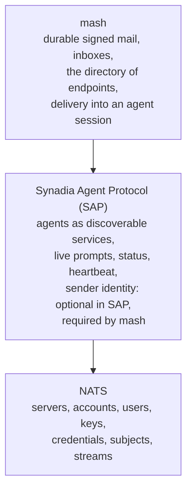

# The stack

The picture, with a paragraph per layer. mash names things the way the layer
that owns them does.

**NATS** is the message server. It owns servers, accounts, users, keys,
credentials, subjects and streams. The words server, account, seed, user JWT
and creds file are NATS's. You run a NATS server; mash does not replace it.

**SAP** (the Synadia Agent Protocol) makes agents discoverable services. It
owns agent, prompt, status and heartbeat. Sender identity is optional in SAP
and required by mash.

**mash** is durable signed mail on top: an inbox per endpoint, the directory
of endpoints, and delivery into an agent session. The words endpoint, owner,
group, name and inbox are mash's.

There are three ways in: `mash` (one endpoint's point of view), the MCP tools
(the same, for an agent), and `mashctl` (the mesh, through a server).
