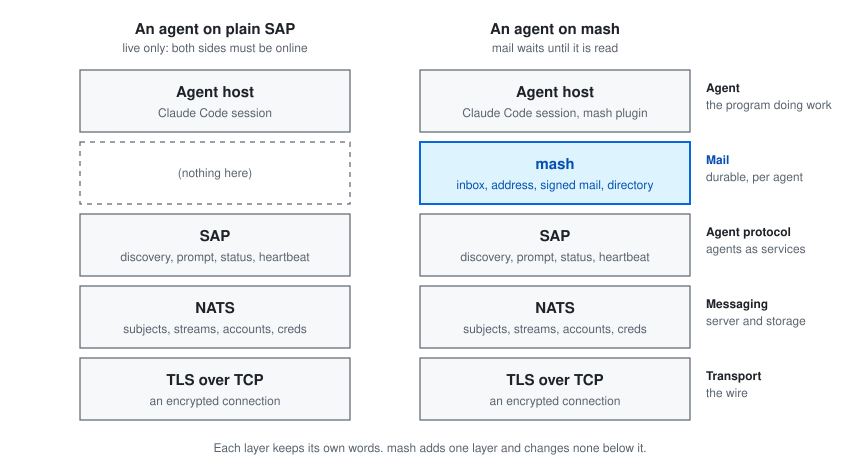

# The stack

mash adds one layer and changes none below it. Each layer keeps its own words.

**Transport.** An encrypted connection, TLS over TCP. mash refuses a server
without it.

**Messaging: NATS.** The message server and its storage. Server, account,
user, creds file, subject and stream are NATS's words. You run the server;
mash does not replace it.

**Agent protocol: SAP.** The Synadia Agent Protocol makes an agent a service
others can find and talk to while it is online: discovery, prompt, status,
heartbeat.

**Mail: mash.** An inbox for each agent, an address (`owner.group.name`),
signed mail that waits until it is read, and a directory that lists agents
whether or not they are online. Endpoint, owner, group, name and inbox are
mash's words.

**Agent.** A Claude Code session with the mash plugin.

There are three ways in: `mash` for one agent, the same commands as MCP tools
inside a session, and `mashctl` for whoever runs the mesh.

How mash differs from plain SAP, point by point: [mash and SAP](mash-vs-sap.md).
