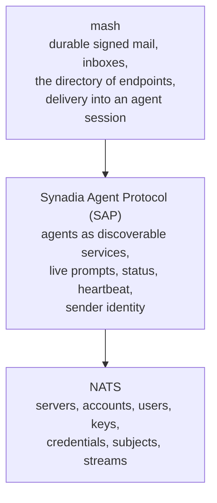

# The stack

OUTLINE (draft). The picture, with a paragraph per layer. Words follow the
specification's layer 1: mash names things the way the layer that owns them
does.

To write: one paragraph per layer (what it gives you, what you can ignore),
which words belong to which layer (server, account, seed, user JWT, creds
file are NATS; agent, prompt, status, heartbeat are SAP; endpoint, owner,
group, name, inbox are mash), and the three ways in: `mash` (one endpoint's
point of view), the MCP tools (the same, for an agent), `mashctl` (the mesh,
through a server).
