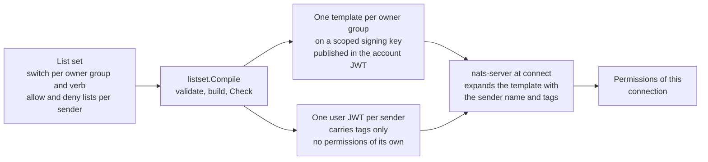
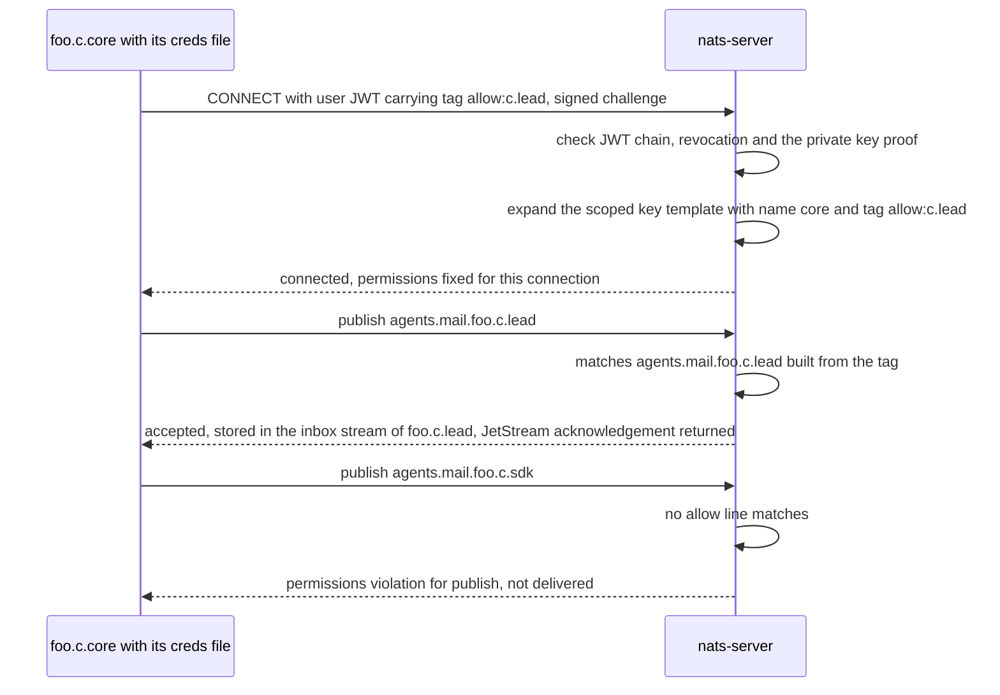
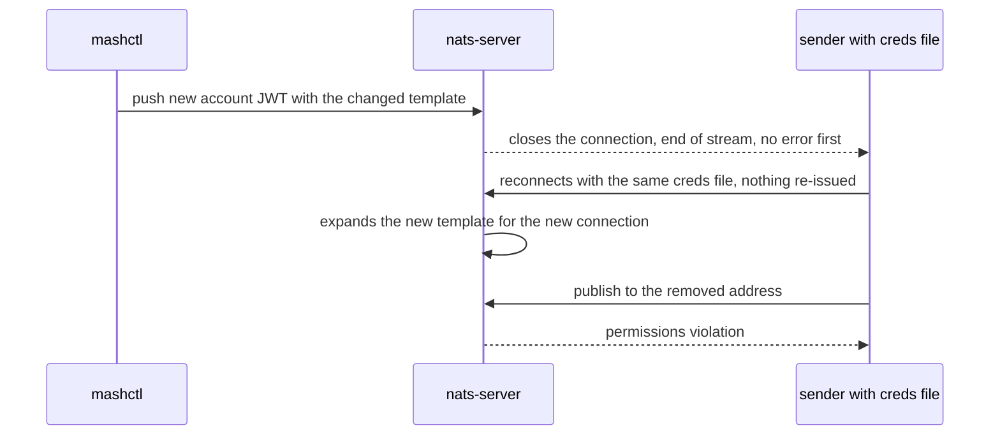
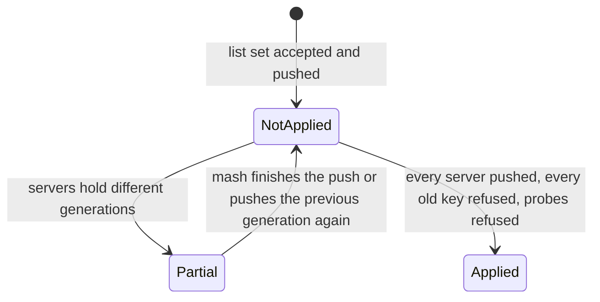

# How mash enforces the messaging policy

> **Drafting status.** This document is written so that an outside reader can check each claim against code, a test or
> a decision record. Some of what it describes is in open pull requests that are not on `main`. Each such statement
> carries a visible `Pending:` note. A maintainer finishes those notes, and removes the matching line here, when the
> pull request lands.
>
> | Item | Where in this file | Waits for | State of the text |
> |---|---|---|---|
> | The applied-policy gate: applied, partial and not applied; generations | section 5.1 | #487 (gate), #488 (live gate), #499 (state and ledger), #489 (ordering) | Written from the contract only. Names no code or test. |
> | Narrowing rotates to a new key with a deadline; removal revokes | section 5.2 | #498 (rotation) | Written from the contract and ADR 0067 only. Names no code or test. |
> | Probe-credential evidence for the gate | sections 5.1 and 6.3 | #488 | Written from the contract and the `probe` purpose that ADR 0101 reserves. |
> | The issue service (REQ-013), ADR 0104, the static wrangler registry | sections 5.3 and 6.8 | the issue-service branch (`pr/core/issue-service`) | Written from ADR 0104 and its tests as they stand on that branch. |
> | Per-sender size table and refusal text (REQ-007, REQ-008), the dry run | sections 6.2 and 7 | the policy-size branch (`pr/core/policy-size`) | Tables copied from that branch's `docs/policy-file.md`. |
> | The raw-client table on the open subjects (AT-020) and the release-gate list (AT-021) | sections 6.1 and 7 | the policy-release-tests branch (`pr/core/policy-release-tests`) | Copied from that branch's `docs/security/threat-model.md` 5.3.1 and `docs/release.md`. |
> | AT-011 on nats-server 2.15.2 | section 4 | the deps-go-group branch (`pr/core/deps-go-group`), ADR 0103 | Figures copied from ADR 0103 on that branch. |
> | #503 (a sender's lost reach to its own address is checked) | section 5.1 | #503 (sdk) | Written from the maintainer's description of the change: it removed an exclusion in the gate that skipped a self-only removal. Names no test. Not yet mapped to an acceptance test: AT-010's contract text does not name the case (section 7). |
> | Mail's lost-publish acknowledgement (REQ-021) | sections 4 and 6.5 | a measurement not yet made | `unmeasured`. To settle: extend the AT-011 test to publish mail (JetStream) at the instant of the close and record the acknowledgement result. |
> | `show`, `explain` (REQ-010), the adoption marker (REQ-016), generation numbers (REQ-017) | sections 5 and 6.6 | not on `main` or on any branch the drafter read | Not yet documented beyond the contract text. |
> | The list set file format (DEC-004) and wiring the compile into `mashctl policy apply` | sections 2 and 5 | a decision and a change not yet made | Nothing outside `internal/listset` imports the compile on this commit. |

## 1. Purpose, and the claim

mash lets an operator decide who may mail, prompt, probe and watch whom, and the NATS server enforces that decision.
The decision is a **list set**: for one NATS account, a switch (shared or closed) for each owner group and each verb,
and for each sending address a list of exact addresses it may reach and a list of exact addresses taken away from it.
mash turns the list set into permission templates and tags. It signs them into credentials, and the server builds each
connection's permissions from those signed credentials at connect. mash is not in the message path and does not check
anything while messages flow.

The claim, in one sentence: **a sender can mail, prompt, probe and watch only the addresses its credential allows, and
the NATS server, not mash at run time, refuses the rest.**

What this document does not claim:

- **It does not claim who may communicate at all.** Every sender can publish to reply and plumbing subjects that the
  lists do not narrow. A raw client can reach another address through them (section 6.1).
- It does not claim anything about message content, rate, or what a receiving agent does with mail it is allowed to
  receive.
- It does not claim that a change takes effect without a reconnect. A change closes the connections under the changed
  key (section 4).
- It does not cover messaging between NATS accounts, hosted Synadia Cloud accounts, or heartbeat and directory
  visibility across owner groups.
- It does not claim that a list set is wired into `mashctl policy apply` today. The compile and its checks exist and
  are tested in `internal/listset`. On this commit nothing outside that package imports it.

Terms are in the [glossary](#8-glossary). The rule behind every section: a statement here is either backed by a file
path, a test name or an ADR number given beside it, or it says "not yet documented".

## 2. How a list set becomes templates and tags

<!-- source: internal/listset/compile.go, internal/listset/check.go, docs/decisions/0102-list-set-permissions-are-one-template-per-owner-group-with-allow-and-deny-tags-and-a-deny-sentinel.md; the output below was printed by calling listset.Compile on the AT-001 shape -->

[ADR 0102](decisions/0102-list-set-permissions-are-one-template-per-owner-group-with-allow-and-deny-tags-and-a-deny-sentinel.md)
fixes the layout. `listset.Compile` (`internal/listset/compile.go`) validates the list set, builds the output, and then
runs `listset.Check` on its own output. It returns nothing if either fails.



### 2.1 The pieces

| Piece | What it is | Source |
|---|---|---|
| Owner group | Every address that shares a range part and an owner part. One scoped signing key per owner group, named `range.owner`. | ADR 0102; `Compile` groups senders by `addr.group()` |
| Template | The permission lines on the scoped signing key. `{{name()}}` and `{{tag(allow)}}` in a line are filled in by the server from the user JWT. | `template()` in `internal/listset/compile.go` |
| Tag | `allow:<owner>.<name>` or `deny:<owner>.<name>`, lower case. The range is a literal in the template, so a tag cannot name another range. One tag covers mail, prompt, status and heartbeat. | `AllowTag`, `DenyTag` in `compile.go`; ADR 0102 |
| Shared or closed | A switch per owner group and verb. Shared puts the owner line (`agents.<verb>.<range>.<owner>.*`) in the template. Closed leaves it out, so only allow tags reach anyone. | `template()`; `TestAT001TemplateNamesNoPeer` |
| Owner line | The one template line that reaches every address of the group. It is the only line that can name a group of addresses. | ADR 0102 |
| Fixed lines | Lines that name only the sender or shared plumbing: its own heartbeat, its own inbox stream and consumer, its reply prefix, its own prompt and status subjects, the directory and its own lease key. They need no tag. | `fixedPub()` in `compile.go`; ADR 0102 |
| Deny lines | Present only in a key where some sender has a deny entry, and only for shared verbs. A deny beats an allow in NATS. | `template()`; ADR 0102 |
| Deny sentinel | The tag `deny:_none`. Every user of a key that has deny lines carries a deny tag, a real one or the sentinel. It expands to a four-token subject, never the five tokens of an address, and `_none` is no part the naming grammar admits. It addresses nothing. | `NoDenyTag` in `compile.go`; `TestSentinelAddressesNothing` |

Two facts about the NATS server shape the layout. Both were verified on nats-server 2.15.1 (ADR 0102, drivers):

1. If every allow line of a template drops out because its tag is missing, the server denies everything. It does not
   open everything. Only a template written with no allow line at all opens everything.
2. A deny line whose tag is missing stops the user connecting.

That is why every template mash emits has at least one allow line that needs no tag (the fixed lines), and why a deny
key needs a deny tag, or the sentinel, on every user. `Check` refuses a template with no tag-free allow line in either
direction (`internal/listset/check.go`; mutation cases in `TestMutationsAreRefused`).

### 2.2 A worked example, generated from the real compile

The shape is the one in AT-001: account `foo`; senders `foo.c.core`, `foo.c.lead` and `foo.c.sdk`; mail, prompt and
heartbeat closed, status shared; the only exception is that `foo.c.core` allows `foo.c.lead`. It is the `at001()`
case of `internal/listset/corpus_test.go`. The text below is the output of a throwaway program that calls
`listset.Compile` on that list set and prints the result. It is not in the repository.

```text
template for scoped key foo.c
  publish allow:
    agents.mail.foo.{{tag(allow)}}
    agents.prompt.foo.{{tag(allow)}}
    agents.status.foo.c.*
    agents.status.foo.{{tag(allow)}}
    agents.hb.foo.c.{{name()}}
    _INBOX.>
    $SRV.>
    $JS.API.INFO
    $JS.API.STREAM.INFO.inbox-foo_c_{{name()}}
    $JS.API.CONSUMER.INFO.inbox-foo_c_{{name()}}.deliver
    $JS.API.CONSUMER.MSG.NEXT.inbox-foo_c_{{name()}}.deliver
    $JS.ACK.inbox-foo_c_{{name()}}.deliver.>
    $JS.API.DIRECT.GET.inbox-foo_c_{{name()}}
    $JS.API.DIRECT.GET.inbox-foo_c_{{name()}}.>
    $JS.API.STREAM.INFO.KV_mash-directory
    $JS.API.DIRECT.GET.KV_mash-directory.>
    $JS.API.STREAM.INFO.KV_mash-leases
    $KV.mash-leases.foo_c_{{name()}}
    $JS.API.DIRECT.GET.KV_mash-leases.$KV.mash-leases.foo_c_{{name()}}
  publish deny:
  subscribe allow:
    agents.hb.foo.{{tag(allow)}}
    _INBOX.foo_c_{{name()}}.>
    agents.prompt.foo.c.{{name()}}
    agents.status.foo.c.{{name()}}
    $SRV.>
  subscribe deny:
user foo.c.core name=core tags=[allow:c.lead]
user foo.c.lead name=lead tags=[]
user foo.c.sdk name=sdk tags=[]
```

How to read it:

- **The shared switch.** Status is shared, so the template has the owner line `agents.status.foo.c.*`. Every sender of
  `foo.c` can probe every other. Mail, prompt and heartbeat are closed, so their owner lines (`agents.mail.foo.c.*`,
  `agents.prompt.foo.c.*`, `agents.hb.foo.c.*`) are absent.
- **The tag line.** `agents.mail.foo.{{tag(allow)}}` expands once per `allow` tag. `foo.c.core` carries
  `allow:c.lead`, so the server builds `agents.mail.foo.c.lead`, `agents.prompt.foo.c.lead`,
  `agents.status.foo.c.lead` and, on the subscribe side, `agents.hb.foo.c.lead`. That one tag is the whole exception.
- **No tag, no reach.** `foo.c.lead` and `foo.c.sdk` carry no tags, so their tag lines drop out. They keep the owner
  line for status and the fixed lines, and nothing else. `foo.c.core` has no line that reaches `foo.c.sdk` for mail,
  prompt or heartbeat. `TestAT001TemplateNamesNoPeer` asserts that the template names no sender, and
  `TestLiveMatchesCheck/AT-001_shape` asserts the server's outcome for every sender and address.
- **The user JWT carries tags and no permissions.** NATS refuses a permission list on a user signed by a scoped key
  (contract REQ-004). `Check` refuses any user with permission claims or with a tag other than `allow:` and `deny:`.

The same compile on a key with a deny entry (mail, prompt and heartbeat shared, status closed, `foo.c.core` denies
`foo.c.sdk`; the `at003Deny` shape) adds deny lines and the sentinel:

<details>
<summary>Real output: a key with a deny entry</summary>

```text
template for scoped key foo.c
  publish allow:
    agents.mail.foo.c.*
    agents.mail.foo.{{tag(allow)}}
    agents.prompt.foo.c.*
    agents.prompt.foo.{{tag(allow)}}
    agents.status.foo.{{tag(allow)}}
    agents.hb.foo.c.{{name()}}
    _INBOX.>
    $SRV.>
    $JS.API.INFO
    $JS.API.STREAM.INFO.inbox-foo_c_{{name()}}
    $JS.API.CONSUMER.INFO.inbox-foo_c_{{name()}}.deliver
    $JS.API.CONSUMER.MSG.NEXT.inbox-foo_c_{{name()}}.deliver
    $JS.ACK.inbox-foo_c_{{name()}}.deliver.>
    $JS.API.DIRECT.GET.inbox-foo_c_{{name()}}
    $JS.API.DIRECT.GET.inbox-foo_c_{{name()}}.>
    $JS.API.STREAM.INFO.KV_mash-directory
    $JS.API.DIRECT.GET.KV_mash-directory.>
    $JS.API.STREAM.INFO.KV_mash-leases
    $KV.mash-leases.foo_c_{{name()}}
    $JS.API.DIRECT.GET.KV_mash-leases.$KV.mash-leases.foo_c_{{name()}}
  publish deny:
    agents.mail.foo.{{tag(deny)}}
    agents.prompt.foo.{{tag(deny)}}
  subscribe allow:
    agents.hb.foo.c.*
    agents.hb.foo.{{tag(allow)}}
    _INBOX.foo_c_{{name()}}.>
    agents.prompt.foo.c.{{name()}}
    agents.status.foo.c.{{name()}}
    $SRV.>
  subscribe deny:
    agents.hb.foo.{{tag(deny)}}
user foo.c.core name=core tags=[deny:c.sdk]
user foo.c.lead name=lead tags=[deny:_none]
user foo.c.sdk name=sdk tags=[deny:_none]
```

</details>

Here `foo.c.core` expands `deny:c.sdk` into `agents.mail.foo.c.sdk` on the publish deny list, so the owner line no
longer reaches `sdk`. `lead` and `sdk` carry `deny:_none`, which expands to `agents.mail.foo._none`: a subject no
address has. Without a deny tag the server would refuse the connection (section 2.1, fact 2). The live case is
`TestLiveMatchesCheck/deny_key_(AT-003)`.

### 2.3 What `Check` proves before anything is signed

`Check` expands every sender's tags through its template the way nats-server does (`expandPermissions` in
`check.go`, written after `processUserPermissionsTemplate` in the server's `auth.go`). It then compares, for each verb,
what the expanded permissions reach with what the lists give: the owner line on shared verbs, plus the allow list,
minus the deny list. It compares over every address the list set names, and over probe addresses in the same group,
in another owner group and in another range. It refuses a mismatch in either direction (ADR 0102, decision outcome).
A live test, `TestLiveMatchesCheck`, then requires the real server's publish and subscribe outcomes to equal the
simulation. So the simulation is itself checked against a real server on every `go test` (it is skipped under `-short`).

### 2.4 What the compile refuses

Wildcards (`*`, `>`), a part that fails the naming grammar, an address in another range, a switch set for one sender,
an owner group that leaves a verb unstated, a deny entry whose owner group has no shared verb or whose target is
outside the sender's own owner group, and duplicates. The whole list set is refused and every bad entry is named
(`TestAT002_BadEntriesRefuseTheWholeSet`, `TestAT002_AllNamedInOneError`, `TestDenyRule`).
mash reads no label, role or group name in the compile: `internal/listset` has no reference to a label outside its
tests, and the owner group comes from the sender's own address.

## 3. What the server checks at connect and on each send

<!-- source: nats-server behaviour as verified in ADR 0102 and ADR 0097; internal/listset/live_test.go (TestLiveMatchesCheck); ADR 0061 -->

Everything below is the stock nats-server in operator mode. mash patches nothing and runs no relay (contract BND-003,
[ADR 0053](decisions/0053-who-may-mail-whom-is-a-policy-file-compiled-by-mashctl-into-nats-permissions.md)).

At connect:

1. **The JWT chain.** The operator key signs the account JWT. The account JWT lists the account's signing keys, and a
   scoped one carries a template. The user JWT names the account as issuer and is signed by a signing key from that
   list. The server checks the chain and the signature, and checks that neither the user key nor the signing key is
   revoked. This is standard NATS JWT authentication. mash relies on it and does not test it. Who signs, and with what
   key, is in section 6.7 and [ADR 0052](decisions/0052-mashctl-mints-nats-users-and-holds-the-account-signing-key.md).
2. **The proof of the private key.** The client signs the server's connect challenge with its private key. The public
   half is in the user JWT. The private key stays on the sender's host.
3. **Template expansion.** The server finds the scoped signing key that signed the user JWT, takes its template, and
   fills in `{{name()}}` from the JWT's name claim and `{{tag(...)}}` from its tags. The result is the connection's
   permission lists. This is what `Check` simulates.

On each publish and subscribe the server matches the subject against those lists. A publish that no allow line matches,
or that a deny line matches, is not delivered, and the connection gets a permissions violation error naming the subject
(ADR 0061). That error is the refusal. A subscribe is refused the same way.



Three consequences:

- The sender cannot widen its own permissions. They come from the template on the signing key and from tags that mash
  put in the signed JWT. A client that edits its creds file breaks the signature.
- A sender can read only its own mail. The template has no line for another address's inbox, prompt or status
  subscription, and every JetStream line names the sender's own inbox stream and consumer only. A live test confirms
  this for a raw client (`TestLiveMatchesCheck`, `TestAT020OpenReplyAndPlumbingSubjectsArePinned`).
- The refusal reaches the sender as an error on the connection, not as a reply to the send. ADR 0061 explains why `mash
  send` says "refused by policy" only when exactly one send is waiting on the subject, and otherwise reports a timeout
  that says a violation was seen.

## 4. What a change does to connected senders

<!-- source: docs/decisions/0097-a-template-change-on-a-scoped-signing-key-closes-open-connections-and-binds-the-reconnect.md; ADR 0103 (open branch); internal/policy/at011_test.go; internal/policy/testdata/at011-result.json -->

A new template reaches a sender by disconnect and reconnect. It does not change a connection that stays open. This was
measured by AT-011 ([ADR 0097](decisions/0097-a-template-change-on-a-scoped-signing-key-closes-open-connections-and-binds-the-reconnect.md)):
a sender connects under its key and stays connected, the template is narrowed or widened, and the new account JWT is
pushed the way `mashctl` pushes it (a request on `$SYS.REQ.CLAIMS.UPDATE`).



| Measure | nats-server 2.15.1, nats.go 1.54.0 (ADR 0097) | nats-server 2.15.2, nats.go 1.55.0 (ADR 0103) |
|---|---|---|
| Server closes the connection at the push | yes, end of stream at 0 ms, no permission violation first | same |
| Reconnect after the push, with a 10 ms reconnect wait | 13 to 123 ms | 13 to 112 ms |
| First refused (narrow) or delivered (widen) publish on the new connection | 23 to 123 ms | 24 to 121 ms (123 ms with 12 busy loops under `-race`) |
| Scenarios, which behaved alike | fixed line narrowed and widened, tag-driven line narrowed and widened | same |
| A fresh connection opened right after the push | bound by the new template at once | same |
| Messages lost outside the disconnect window | none | none |
| Runs | 20 under `-race`, 10 with eight busy loops | 20 under `-race`, 10 with 12 busy loops |

> Pending: the 2.15.2 column describes ADR 0103, not yet merged (`pr/core/deps-go-group`). On `main`, `go.mod` pins
> nats-server 2.15.1, and `internal/policy/testdata/at011-result.json` records 2.15.1.

In one phrase: about 0.1 s. That figure is the **test client's**, which waits 10 ms before it reconnects. A mash
endpoint waits 2 s (`nats.ReconnectWait(2*time.Second)` and `nats.MaxReconnects(-1)` in `internal/endpoint/endpoint.go`),
so ADR 0097 expects an endpoint to be bound by a change about 2 s after the push, plus the reconnect. That 2 s figure
is inferred from the wait. It was not measured.

What this means for a reader who must defend the policy:

- **Every connection under the key is closed**, not only the senders whose tags changed. A push is a short outage for
  the whole owner group. The contract says so for narrowing (REQ-014) and for the new-receiver order (REQ-015).
- **The same credentials bind to the new template.** No credential is re-issued for a template change. Fixed lines and
  tag-driven lines behave the same, for narrowing and widening alike.
- **A client that does not reconnect is cut off.** The server closed its connection, so it is closed, not left on the
  old template. A mash endpoint reconnects without limit.
- **A message in flight at the close can be lost.** In a few runs, one or two messages sent in the instant the server
  closed the socket were lost (ADR 0097; one message on 2.15.2, ADR 0103). Messages sent while the client was
  disconnected were held by the client and delivered after the reconnect. The measured loss is only for messages in
  flight at the close.
- **Mail and prompts differ in what the sender learns.** Mail's JetStream-backed publish is **expected** to surface a
  lost publish as a failed acknowledgement, which is **not yet measured** (`unmeasured`; contract REQ-021). AT-011
  measured core NATS subjects: a plain publish whose loss is not reported. If the expectation holds, a retry with the
  same idempotency key stores the message once ([ADR 0031](decisions/0031-send-at-most-once-with-an-idempotency-key.md)).
  Prompts and heartbeats are core NATS, so a lost one is not reported to the sender. ADR 0097 says "mail is durable in
  the inbox stream and a publisher that needs the message to arrive confirms it". To settle: extend the AT-011 test to
  publish mail (JetStream) at the instant of the close and record the acknowledgement result.
- **The result is guarded.** `TestAT011TemplateChangeReachesOpenConnections` runs the four scenarios on every `go
  test`. It compares outcome classes (`after_reconnect`, `reconnected`, no loss outside the disconnect, fresh
  connection `changed`) and the server version with `internal/policy/testdata/at011-result.json`. It fails when either
  differs, and says so. The maintainer then runs `MASH_AT011_UPDATE=1 go test -run TestAT011 ./internal/policy/`,
  commits the record, and writes an ADR that amends the last. The release gate lists this test as required (section 7).

## 5. The gate, rotation and the issue record

This section describes the parts of the enforcement that make a change count as applied. Most of it is work in open
pull requests. It is written from the contract text (`mash-messaging-policy`, draft-3) and from the records that exist.

### 5.1 The applied-policy gate

> Pending: describes #487, #488, #499 and #489, not yet merged. Not yet documented: the command names, output layout,
> the generation counter's storage, the deadline values, and any test names. The text below restates the contract
> (REQ-011, REQ-012, REQ-015, REQ-017, AT-010) and nothing else.

A list set counts as **applied** only when:

1. every server has taken the push,
2. every revoked key is refused on every server, and
3. a live send to a removed receiver is refused on every server, with each old sender's permissions and from a
   connection that was open before the change.

mash holds no sender private key, so it cannot send as the old credential. The gate instead mints a short-lived probe
credential under the same owner group's key, with the sender's old name and tags (so it has the same effective
permissions), reconnects it, and checks that it is refused on the removed receiver on every server. The old key's own
refusal is shown by every server's account JWT revoking it. Each probe is written to the issue record with purpose
`probe` and revoked when the gate ends. The record's `probe` purpose exists on `main` and is reserved for this (ADR
0101); no mash path writes it yet.

The gate's expectations include a sender losing reach to its **own** address: a removal where the only thing taken from
a sender is its own address (a self-only removal). A gate that skipped that case would pass a list set under which the
sender can still reach itself. #503 removed an exclusion in the gate that skipped it, so a sender's lost reach to its own
address is checked like any other removed receiver.

> Pending: describes #503, not yet merged. Written from the maintainer's description of the change. Not yet documented:
> the test names and the output. The contract text of REQ-011 and AT-010 does not name the self-only case.

Because a template push closes every connection under the key (section 4), the gate expects a disconnect and then a
reconnected sender that is refused. A connection that was open before the change counts as refused by being closed. The
gate does not wait for a send on it.

States, as the contract's wording gives them. The diagram is drawn from the contract text, not from code:



| State | Meaning (contract) |
|---|---|
| Refused | The whole list set is rejected before anything is signed. Nothing is pushed. The previous generation stays in force (INV-003, JRN-003). |
| Not applied | The push happened, or began, and the gate has not passed. The report names the servers and senders that fail. |
| Partial | Servers hold different generations. `show` reports each server's generation and no account-wide policy in force, until mash brings every server to one generation (JRN-004). |
| Applied | The gate passed on every server. `show` reports the generation as applied. |

A **generation** is a number given to each accepted list set, with the digest of the list set as received and of what
was signed. A list set whose stated base is not the generation in force is refused (REQ-017, AT-016). On `main`, the
issue record's `generation` field is 0 because mash has no generation yet (ADR 0101).

### 5.2 Narrowing rotates, removal revokes

> Pending: describes #498, not yet merged. Not yet documented: the handover deadline's length, the retry behaviour and
> test names. The text below is REQ-014 and AT-013, plus ADR 0067 for what `mashctl reissue` does today.

- When a sender's tags narrow, mash issues the new credential to a **new public key**, waits until the servers show a
  connection with that key, then revokes every key the issue record holds for that address except the new one, and
  pushes. A wrangler's report that the file is in place is not enough.
- A deadline bounds the handover. If no connection with the new key is seen by then, mash revokes the old keys anyway,
  reports the sender as not connected, and keeps the change not applied for that sender until it connects.
- When a sender leaves the list set, mash revokes every key the issue record holds for it, and pushes.
- Each push disconnects every sender under that owner group's key (section 4). The dry run names those senders.

What exists on `main` is the earlier rule of [ADR 0067](decisions/0067-a-reissue-that-narrows-an-endpoint-rotates-its-user-key-and-revokes-the-old-one.md):
`mashctl reissue` mints a new user key and revokes the old one when the new credential carries fewer permissions, adds
a deny tag, or is signed by a different key, and it never re-signs a key the account JWT already revokes.

### 5.3 Issuing a credential: the issue service and the issue record

**The issue record (on `main`).** [ADR 0101](decisions/0101-every-issued-user-jwt-is-recorded-in-a-bucket-only-the-admin-connection-writes.md)
records every user JWT `mashctl` issues in the KV bucket `mash-issued`, keyed by public key. An entry holds the public
key, address, owner, kind, tags, generation, issue time, purpose (`issue`, `rotation` or `probe`) and a revocation time
once mash has revoked the key. It never holds a seed or a JWT.

- **Written before the creds exist.** `mashctl add` and `mashctl reissue` write the entry after minting in memory and
  before the directory record or any file, so a failed write issues nothing.
- **Only the admin connection writes it.** No permission list mash makes grants anything on `$KV.mash-issued.>` or the
  stream's `$JS.API` subjects. A test asserts it for each list and against a live endpoint connection, which is refused
  a write, a read, a listing and a purge. The stream refuses rollup, message delete and purge.
- **Append only.** A rotation adds an entry and leaves the old key's. The one change to an entry is `revoked_at`.
- **The drift check.** `mashctl issued check` compares the public keys connected to every server with the record and
  reports any key mash did not issue (exit 1), and any recorded-revoked key still connected (exit 1). It refuses an
  incomplete server set (exit 2). Tests: `TestAddRecordsTheIssuedUser`, `TestIssuedCheckReportsAKeyMashDidNotIssue`,
  `TestIssuedCheckRefusesAnIncompleteServerSet`, `TestIssuedPurposePerPath` in `cmd/mashctl/issued_test.go`.
- **Its limit.** The check sees only connections open when it runs, and a holder of the admin creds can add a record.
  The record guards against a copied signing key, not against the admin creds (ADR 0101; threat model section 10).

**The issue service (REQ-013).**

> Pending: describes ADR 0104 and `cmd/mashctl/issuecmd_test.go` on `pr/core/issue-service`, not yet merged.

[ADR 0104](decisions/0104-an-issue-service-signs-a-credential-for-a-public-key-a-wrangler-countersigned.md) lets a
wrangler on a sender's host ask for a credential for a public key, without any private key leaving the host.
`mashctl issue serve` answers on `agents.issue.<range>.<owner>`. The request names an address, a public key, a host, a
nonce and an expiry, and carries the wrangler's signature over those fields. The service signs only if all of these
hold:

| Check | What it refuses |
|---|---|
| The request is well formed, within 4,096 bytes, and its subject names the address's owner group | malformed or oversize requests, a request on the wrong owner group's subject |
| `expires` is in the future and no more than five minutes ahead | expired requests, an expiry set far ahead |
| The wrangler key is registered for exactly this host and owner group, and the proof verifies over `mash-issue-v1`, address, public key, host, nonce and expiry | a forged or missing proof. A proof valid for `foo.c.core` fails for `foo.c.sdk`, because the address is in the signed bytes. |
| The nonce has not been seen | a replayed request |
| The address is a sender in the list set in force | an unlisted address |
| The public key is not revoked in the issue record and not bound there to another address | a revoked key, a key already bound elsewhere |
| The owner group's signing key is published in the account JWT as a scoped signer whose template equals the list set's template for the group | an unscoped key, or a key whose template differs |

Tags, permissions, limits, a name or an expiry in a request are never read. The tags come from mash's own table (the
compile of section 2). The record write comes before the reply and is the arbiter between concurrent requests: of two
requests for one key and two addresses, exactly one succeeds. No private key is made, received, stored or logged on this
path; `TestIssueServiceAT012NoPrivateKeyAnywhere` scans the NATS payloads and the log for seeds. No template mash
compiles has a line that reaches `agents.issue.>` (`TestIssueSubjectIsNotReachableByATemplate`), so an endpoint cannot
publish to the service.

What the countersignature proves, and what it trusts, from ADR 0104: it proves that the holder of the wrangler's
private key asked for this public key to be bound to this address from this host, now. It trusts the wrangler to tell
its senders apart and to ask only for the address a key pair belongs to. A compromised wrangler can have any address
registered to its host and owner group signed for a key it chooses.

## 6. The limits mash cannot remove

### 6.1 The open reply and plumbing subjects

<!-- source: docs/security/threat-model.md section 5.3.1, from pr/core/policy-release-tests; test TestAT020OpenReplyAndPlumbingSubjectsArePinned in internal/listset/at_live_test.go on that branch -->

> Pending: the table below is copied from `docs/security/threat-model.md` 5.3.1 and `TestAT020OpenReplyAndPlumbingSubjectsArePinned` on
> `pr/core/policy-release-tests`, not yet merged. The same table lives in [the threat model](security/threat-model.md)
> once that branch lands; change both together.

A raw client is a plain NATS client holding one sender's creds file (its signed user JWT: tags and no permissions of its
own). Under list-set enforcement ([ADR 0102](decisions/0102-list-set-permissions-are-one-template-per-owner-group-with-allow-and-deny-tags-and-a-deny-sentinel.md)) it publishes mail, prompt and status only to the
addresses its lists give, and it cannot subscribe to another address's inbox, prompt or status subjects. A few lines of
every template stay open to every sender, because replies, discovery and the directory need them. The table is what a
raw client of `foo.c.core` reaches on them, measured against a real nats-server by
`TestAT020OpenReplyAndPlumbingSubjectsArePinned` (`internal/listset/at_live_test.go`). The test pins the table: a
change that widens or narrows what is reachable fails it, and the maintainer who changes the test updates this table.

| Subject (as the raw client publishes it) | Server | Reaches another address | Why it stays open |
|---|---|---|---|
| `_INBOX.<other flat name>.<id>` | accepted | yes: delivered to the other address, in its own and in another owner group | A reply is a plain publish to the caller's reply prefix; there is no response permission, which allowed deleting another's inbox ([ADR 0007](decisions/0007-one-nats-user-per-endpoint-least-privilege.md)). The receiver accepts only verified callers, and a prompt's reply subject carries 128 random bits (threat model, section 6.4). |
| `$SRV.INFO.agents`, `$SRV.PING` and the rest of `$SRV.>` | accepted | yes: delivered to every sender (each subscribes to `$SRV.>`) | Discovery and live prompts are service requests to every endpoint ([ADR 0007](decisions/0007-one-nats-user-per-endpoint-least-privilege.md)). |
| `_INBOX.<own flat name>.<id>`, its own heartbeat, its own inbox consumer, its own lease key | accepted | no | Fixed lines naming only the sender ([ADR 0009](decisions/0009-one-inbox-stream-and-consumer-per-endpoint.md)). |
| `$JS.API.INFO`, `$JS.API.STREAM.INFO.KV_mash-directory`, `$JS.API.DIRECT.GET.KV_mash-directory.>`, `$JS.API.STREAM.INFO.KV_mash-leases` | accepted | no: server API reads; the directory is readable by every sender | Needed to resolve names and read the lease bucket state; read only. |
| Another address's lease key (`$KV.mash-leases.<flat>`), a read of it, and any write to `$KV.mash-directory.>` | refused | no | A sender writes only its own lease and never the directory. |
| Another address's inbox stream: `STREAM.INFO`, `CONSUMER.INFO`, `CONSUMER.CREATE`, `CONSUMER.DURABLE.CREATE`, `CONSUMER.MSG.NEXT`, `$JS.ACK`, `STREAM.MSG.GET`, `DIRECT.GET`, `STREAM.DELETE`, `STREAM.PURGE` | refused | no | Every JetStream line names the sender's own inbox stream only. |
| Another address's heartbeat | refused | no | Publish only to its own heartbeat. |

What a raw client can therefore do: send an unlisted address a reply-prefix publish (`_INBOX.<other>.<id>`), or a
`$SRV.>` request, and what the receiver does with it rests on its own checks (verified callers, random reply subjects), not on the server. It
cannot mail, prompt or probe an address its lists do not give, and it cannot read, consume or delete another inbox.
Subscribing to another address's inbox, prompt and status subjects, or to a wider reply prefix (`_INBOX.>`, `agents.>`,
`$JS.API.>`), is refused; the same test checks each.

The lines are visible in the section 2.2 output: `_INBOX.>` and `$SRV.>` in publish allow. Narrowing them is another
workstream's work (the SDK's reply subjects). Until then this document guarantees who may mail, prompt, probe and watch
whom, and not who may communicate at all (contract section 1, non-goals; REQ-010, REQ-021).

### 6.2 Size limits

<!-- source: docs/policy-file.md "How many exceptions one sender can have", from pr/core/policy-size; contract REQ-007, REQ-008 -->

> Pending: the tables and the refusal text below are copied from `docs/policy-file.md` on `pr/core/policy-size`, not yet
> merged. That branch's measure, `listset.SizeCheck`, is not wired into `mashctl policy apply`: apply still measures the
> older compile. The tables measure the list set compile of section 2. The source does not record the nats-server version
> of the calibration.

A user's JWT travels in the connect line, which a default server caps at 4,096 bytes (`max_control_line`). Every
exception is a tag, and tags are what make the JWT grow. mash **refuses on measured size, never on a count**
(REQ-007, REQ-008). Before anything is signed or pushed it measures each sender's user JWT inside the whole connect
line, and each account JWT, against the limit of every server, and it refuses the whole list set when any does not fit
on any server. It never drops, merges or widens an exception to make a credential fit.

An exception is one address on a sender's allow or deny list, counted once across all verbs. The tag value is the
address without the range, so a tag costs the length of the receiver's owner part and name. The deny sentinel
`deny:_none` is a tag but not an exception. It costs one tag (13 bytes of JSON) on a sender whose group has a deny entry
and who has none of its own.

**The headline** (contract REQ-008, measured correction, 2026-11-12): about 100 exceptions per sender at names of 10
characters or less. The tables below are the measure. Between the 7-character and 14-character columns of the first
table (114 and 85 at an owner part of 4), about 100 at 10 characters is an interpolation and is not itself a measured
row. An earlier figure in the contract's first drafts (151 tags at 7 characters, 105 at 14, 59 at 32) counted bare tag
values and does not hold for real credentials.

At the default connect line of 4,096 bytes, the most exceptions one sender can have, measured with the real compile.
The columns are the length of every name (the sender's and each receiver's); the rows are the length of the receiver's
owner part; the range is 3 characters. A deny exception names a member of the sender's own owner group, so its owner
part is the sender's. A range, an owner part and a name total at most 62 characters.

Allow exceptions on a closed verb (no sentinel):

| Owner part | 7-character names | 14-character names | 32-character names |
| --- | --- | --- | --- |
| 4 | 114 | 85 | 51 |
| 8 | 95 | 74 | 47 |
| 14 | 77 | 62 | 42 |
| 24 | 58 | 49 | 35 |

The same allow exceptions for a sender that also carries the sentinel (its group has a deny entry and the sender has none):

| Owner part | 7-character names | 14-character names | 32-character names |
| --- | --- | --- | --- |
| 4 | 113 | 84 | 50 |
| 8 | 95 | 74 | 46 |
| 14 | 76 | 62 | 41 |
| 24 | 58 | 49 | 35 |

Deny exceptions on a shared verb (the sender has its own denies, so no sentinel):

| Owner part | 7-character names | 14-character names | 32-character names |
| --- | --- | --- | --- |
| 4 | 119 | 88 | 52 |
| 8 | 99 | 76 | 48 |
| 14 | 79 | 64 | 42 |
| 24 | 59 | 50 | 36 |

A worked example. A sender that may mail 60 receivers in an owner group of 14 characters, each with a 14-character
name, fits (the limit is 62). At 63 it does not, and mash says so:

```text
sender "rng.sxx.r0000000000000" (group "rng.sxx"): its connect line would be 4,106 bytes with 63 exceptions (63 tags); server "default server limit" allows 4,096 (max_control_line)
Use a shared verb instead of a long list of exceptions (docs/policy-file.md).
```

The same sender with owner parts of 4 characters and names of 7 characters fits 114. The bytes are the rule, not the
count. A cluster is limited by its smallest server, and the message names the server that would not take the credential.
An account JWT that does not fit a server is refused the same way, naming the account. It grows with the number of owner
groups and the shared verbs they hold, never with the number of senders. The measure is conservative by at most 6 bytes:
a credential within 6 bytes of the limit may be refused although the server would take it, and one the measure accepts
always connects. Tests on that branch: `TestDocumentedExceptionTable`, `TestSizeCheckBoundaryIsTheDocumentedTable`,
`TestSizeCheckMeasuresTheFullConnectLine` in `internal/listset/size_test.go`.

**The way out** is a shared verb instead of a long list of exceptions: share the verb in the owner group, so its senders
reach each other through the owner line (no tag), and keep the list for the few addresses outside the group. A server
that runs a larger `max_control_line` holds more: the limit is the server's own.

### 6.3 Probe-credential evidence

> Pending: describes #488, not yet merged. Not yet documented.

The applied gate's evidence for a withdrawn permission is a probe credential, not a send as the old sender (section 5.1).
So the evidence has three parts: the probe is refused on every server, every server's account JWT revokes each old key,
and each probe is in the issue record. It is evidence that the same effective permissions are refused. It is not a
replay of the old connection, because mash holds no sender seed.

### 6.4 Labels are unsigned metadata

A directory record may carry labels. `docs/architecture.md`, Appendix C, row "Directory labels", says: labels are
unsigned metadata, the record carries no signature, anyone who can write the directory can set them, and nothing may
make a security decision on a label. The authority is the signed user JWT. The list set compile reads no label
(section 2.4). A label in a directory record must not drive a decision in a tool that sits beside mash, either.

### 6.5 Core NATS publishes at the close

A template push closes connections. A prompt, a status probe or a heartbeat that is in flight at that instant can be lost,
and the sender is not told, because those are core NATS publishes (section 4). Mail's JetStream-backed publish is expected
to surface a lost publish as a failed acknowledgement (REQ-021), which is `unmeasured`: AT-011 measured core NATS
subjects only. A publisher that needs a message to arrive confirms it (ADR 0097).

### 6.6 What the policy covers, and running one account both ways

The lists cover four verbs: mail, prompt, status and heartbeat. Every verb must be stated for every owner group, and mash
never infers one verb's switch from another (REQ-002). Other traffic is not under the lists: the reply and plumbing
subjects (section 6.1), and the directory reads that every sender needs.

An account is run **either** with the marker that says an outside system owns its list sets, **or** open (or
owner-line-only). One account run both ways is not supported (contract REQ-016, from the maintainer's ruling of
2026-11-11: "Running mash with both [an outside owner of the policy] and without is not supported. Documented.").

> Pending: the marker, its submitter key, the refusal of direct policy changes on a marked account, and the
> reconciliation at adoption are REQ-016, not on `main` and not on any branch the drafter read. Not yet documented
> beyond the contract text. On `main` there is no adoption marker.

### 6.7 Credential custody

<!-- source: docs/security/threat-model.md section 10 "Who holds which key"; the group-key and wrangler rows are from pr/core/issue-service -->

The enforcement is only as strong as the custody of the keys that sign credentials. In one table (the full text, with
what to do when each leaks, is [threat model section 10](security/threat-model.md#10-who-holds-which-key)):

| Key or credential | Held by | What a holder can do |
|---|---|---|
| Operator key | the operator host's user (only where mash stood the server up) | Sign account JWTs and revocations, so replace any account's JWT and push it. |
| Account identity key | the operator host's user | Sign a user with no permission limits, unless the operator enforces strict signing key usage. |
| Scoped signing keys (one per owner group, in the account JWT with a template) | the minting authority only (`mashctl`'s key store); never a sender's host | Sign a user JWT that takes the group's template, with any name and tags. Policy limits what the key's honest users get, not the key's holder. |
| System account creds | the operator host's user | Read connection state, push claims updates. The server accepts a pushed account JWT only if the operator signed it. |
| Admin creds | the operator host's user | Everything within the account, including writing the issue record. |
| Endpoint creds (user JWT and seed) | the host that runs that endpoint | Be that endpoint, under its permissions. No access to the issue record. |
| Wrangler key (the countersigning key, public half in a registry) | the wrangler on each sender's host | Have any address of its registered host and owner group signed for a public key it chooses. |

> Pending: the rows for the owner group signing keys (`groups/<range>.<owner>.nk`) and wranglers come from
> `docs/security/threat-model.md` on `pr/core/issue-service`, not yet merged. On `main` the signing keys in the key store
> are zone keys.

The custody rule: scoped signing keys stay with the minting authority, and a sender's host holds only its own creds.
`mashctl issued check` shows a user signed outside the authority with a copied key (section 5.3). The modes on the key
store stop other users and not other processes of the same user; the threat model says to keep it under a separate user
or on a mount agent sessions cannot read.

### 6.8 The static wrangler registry is for test accounts

> Pending: describes ADR 0104 on `pr/core/issue-service`, not yet merged.

How a real wrangler's key comes to be registered for a host and owner group is **not decided** (contract DEC-002, open
part). Until it is, mash ships only a static registry, `wranglers.json` in the key store directory, managed by `mashctl
wrangler init --test-account`, `add`, `list` and `remove`. `mashctl issue serve` needs the operator's own `--test-account`
flag and a registry that says `test_account: true`, and refuses to start otherwise, with `no wrangler registry for this
account: the static registry is for test accounts only; real wrangler registration is not decided yet`. This is not a
statement that wrangler keys should be registered this way on a real account.

## 7. How each claim is tested

<!-- source: scripts/releasecheck/policytests.txt from pr/core/policy-release-tests; test names read from main and from the open branches named in the Status column -->

The release gate runs the rows marked **required** on every release and every NATS server version change, and a failure
blocks the release ([docs/release.md](release.md#policy-tests-on-every-release), contract REQ-020, AT-021). A row that
is `pending` in `scripts/releasecheck/policytests.txt` prints a notice and does not fail the gate.

| AT | What is claimed | Test or evidence | Status |
|---|---|---|---|
| AT-001 | Exact lists become enforced permissions: allowed sends pass, others are refused, from a raw client | `TestAT001TemplateNamesNoPeer`, `TestLiveMatchesCheck/AT-001_shape` (`internal/listset`) | on `main`; required in the gate list |
| AT-002 | A bad entry refuses the whole set, naming each | `TestAT002_BadEntriesRefuseTheWholeSet`, `TestAT002_AllNamedInOneError`, `TestDenyRule` (`internal/listset`) | on `main`. The half that an account JWT and the issue record stay unchanged has no test: no apply path uses the compile yet. |
| AT-003 | Closing a verb drops the owner line, sharing restores it, a deny holds with every user carrying a deny tag | `TestLiveMatchesCheck/deny_key_(AT-003)`, `TestAT003OwnerLineDroppedAndDenyHolds` | the first on `main`; the second on `pr/core/policy-release-tests`; required |
| AT-004 | Compiled output fails closed: a tag-free allow line, tags only, effective permissions equal the lists | `TestAT004_Corpus`, `TestAT004_ZeroTags`, `TestMutationsAreRefused` | on `main`; required |
| AT-005 | A deny-all sender is refused everywhere and still reaches its own inbox | `TestAT005DenyAllSenderIsRefused` | `pr/core/policy-release-tests`; required. The half that an issue request lacking a deny tag is refused before signing: not yet documented. |
| AT-006 | An oversize credential or account JWT is refused before issue or push | `TestSizeCheckNamesTheServerThatDoesNotFit`, `TestSizeCheckAccountJWT` (`internal/listset`), `TestSmallestServerRefusesTheWholeSet` (`internal/apply`) | `pr/core/policy-size`; pending |
| AT-007 | The documented exception limit matches the measured table | `TestDocumentedExceptionTable`, `TestSizeCheckBoundaryIsTheDocumentedTable` | `pr/core/policy-size`; pending |
| AT-008 | The dry run lists exactly the changes and changes nothing | `TestDryRunAT008Golden`, `TestAT008Content`, `TestDryRunDoesNotMutateItsInputs` | `pr/core/policy-size`; pending |
| AT-009 | `explain` and `show` work without admin rights and name what they describe | not yet documented | no test found |
| AT-010 | The applied gate, on a cluster of two or more servers | pending: #488. The gate's check of a sender's lost reach to its own address (#503) is not yet mapped to AT-010: the contract's AT-010 text does not name a self-only removal. | pending; `pending` row in the gate list |
| AT-011 | A template change closes the connection and the reconnect is bound by the new template | `TestAT011TemplateChangeReachesOpenConnections` (`internal/policy`), [ADR 0097](decisions/0097-a-template-change-on-a-scoped-signing-key-closes-open-connections-and-binds-the-reconnect.md), ADR 0103 | on `main` (2.15.1); ADR 0103 on `pr/core/deps-go-group` (2.15.2); required. It measured core NATS subjects only; mail's acknowledgement at the close is `unmeasured`. |
| AT-012 | A credential for a public key, for exactly one address, with no private key anywhere | `TestIssueServiceAT012IssuesAJWTThatConnects`, `TestIssueServiceAT012NoPrivateKeyAnywhere`, `TestIssueServiceAT012Refusals`, `TestIssueServiceIgnoresTagsAndPermissionsInARequest` (`cmd/mashctl`), [ADR 0104](decisions/0104-an-issue-service-signs-a-credential-for-a-public-key-a-wrangler-countersigned.md) | `pr/core/issue-service`; not in the gate list |
| AT-013 | Narrowing rotates, revokes and causes no outage | pending: #498 | pending |
| AT-014 | A new receiver is reachable only after the senders that must refuse it | pending: #489 | pending |
| AT-015 | An adopted account takes list sets only from its owner | not yet documented | no test found |
| AT-016 | A stale generation is refused | pending: #499 | pending |
| AT-017 | The issue record holds every issued JWT, and a foreign key is reported | `TestAddRecordsTheIssuedUser`, `TestIssuedCheckReportsAKeyMashDidNotIssue` (`cmd/mashctl/issued_test.go`), [ADR 0101](decisions/0101-every-issued-user-jwt-is-recorded-in-a-bucket-only-the-admin-connection-writes.md) | on `main` for `add`, `reissue` and the drift check. The record cannot yet hold JWTs from the gate or rotation paths. |
| AT-018 | Zones are gone | [ADR 0091](decisions/0091-there-are-no-zones-mail-keeps-the-five-token-subject-and-the-address-is-the-fence.md) decides it | not complete on this commit: `internal/policy` and `docs/policy-file.md` still carry zones |
| AT-019 | Lists are one direction only | the case "cross-group allows go one way" of `TestLiveMatchesCheck` | on `main`. The half that a live prompt still gets its direct answer: not yet documented. |
| AT-020 | A raw client gets no more than its lists, and the open subjects are pinned | `TestLiveMatchesCheck`, `TestAT020OpenReplyAndPlumbingSubjectsArePinned` | the first on `main`; the second on `pr/core/policy-release-tests`; required |
| AT-021 | The release pipeline runs these tests and a failure blocks it | `scripts/releasecheck/policytests.txt`, `scripts/releasecheck/policytests_test.go`, `.github/workflows/policy-tests.yml`, [docs/release.md](release.md#policy-tests-on-every-release) | `pr/core/policy-release-tests`. The gate lists AT-001, AT-003, AT-004, AT-005, AT-011 and AT-020 as required. It does not yet run AT-010. |
| AT-022 | This document exists with its diagrams, AT-011 result, custody, raw-client limit and the not-supported statement | inspection of this file | this file |

## 8. Glossary

| Term | Meaning |
|---|---|
| Address | A three-part name: range part, owner part and name part, as in `agents.mail.foo.c.core` (range `foo`, owner `c`, name `core`). |
| Owner group | Every address that shares one range part and one owner part. |
| Verb | One kind of traffic: mail, prompt (a live request to a running session), status (a liveness probe) or heartbeat (the periodic "I am here" signal). |
| Shared, closed | The switch for one owner group and one verb. Shared: the owner line is on. Closed: a sender reaches only the addresses on its allow list. |
| List set | The switches and lists for one NATS account, handed over in one piece. |
| Allow list, deny list | For one sending address: exact addresses it may reach beyond the owner line, and exact addresses taken away from a shared verb. |
| Exception | One address on one sender's allow or deny list. It costs one tag, which covers all four verbs. |
| Account JWT | The signed record of one NATS account: its signing keys, any template on them, and revoked keys. |
| User JWT, creds file | A signed token naming a sender's public key, kept with the sender's private key in a creds file on its host. |
| Scoped signing key | A signing key whose permissions are fixed in the account JWT. A user JWT it signs carries tags and no permissions. |
| Template | The permission lines on a scoped signing key. `{{name()}}` and `{{tag(...)}}` are filled in by the server at connect. |
| Tag | A `key:value` entry in a user JWT that the template turns into permission lines. |
| Owner line | A template line that reaches every address of an owner group (`agents.mail.foo.c.*`). |
| Fixed lines | Template lines that name only the sender or shared plumbing and need no tag. |
| Deny sentinel | The tag `deny:_none`, carried by users of a key with deny lines, which addresses nothing. |
| Push | Sending a new account JWT to the servers. |
| Revoke | List a key in the account JWT as no longer valid. Each server then closes that key's connections and refuses it. |
| Connect line | The first line a client sends. It carries the user JWT. A default server caps it at 4,096 bytes. |
| Minting authority | The service that signs user JWTs with the scoped signing keys. It runs with `mashctl`, where the keys sit. |
| Wrangler | The component on each sender's host that makes the key pair and asks for a credential. It holds no signing key. |
| Raw client | A plain NATS client that uses one sender's creds file and nothing of mash. |
| Applied | A list set is applied when the gate has passed on every server (section 5.1). |

See also: [the policy file](policy-file.md), [mash architecture](architecture.md), [the threat model](security/threat-model.md),
[releasing mash](release.md).
